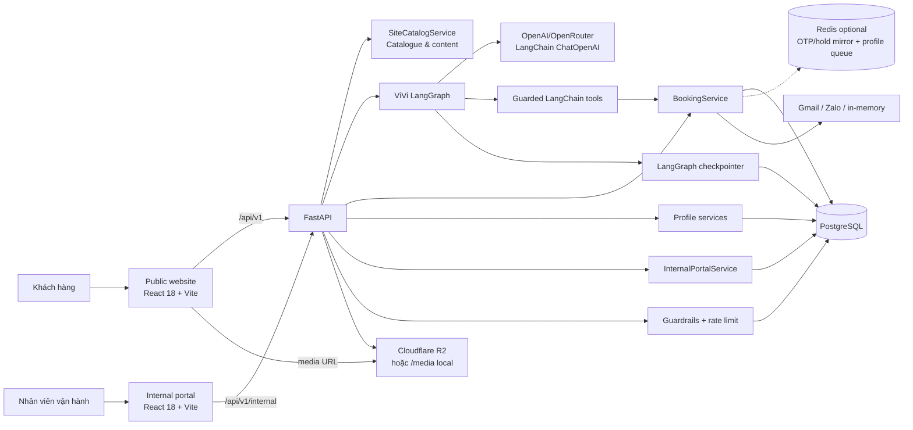
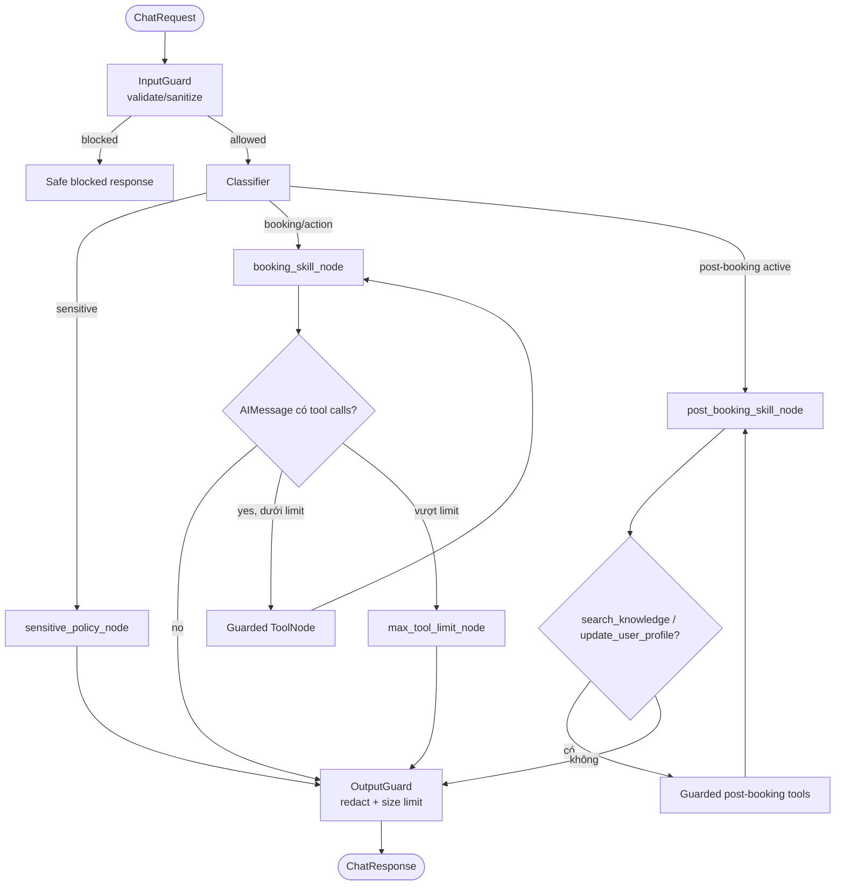

# Tài liệu Kiến trúc Hệ thống VinFast Test Drive + Trợ lý ViVi

> Tài liệu mô tả cách triển khai mã nguồn hiện hành trong các thư mục `frontend/src`, `internal-portal/frontend/src` và `backend/src`, được nhóm em đối chiếu hoàn chỉnh với mã nguồn dự án ngày 01-09-2026. Trong mọi trường hợp có sự khác biệt, mã nguồn thực tế luôn được xem là nguồn thông tin chính xác nhất.

---

## 1. Tổng quan dự án

Nhóm em phát triển hệ thống này nhằm phục vụ trọn vẹn hành trình tìm hiểu xe và đăng ký lái thử các dòng ô tô điện VinFast. Dự án bao gồm trang web công khai dành cho khách hàng, trợ lý ảo ViVi tư vấn thông minh, cổng thông tin nội bộ cho đội ngũ vận hành và máy chủ xử lý trung tâm FastAPI dùng chung.




### Bảng quản lý nguồn dữ liệu chính xác (Source of Truth)

| Loại dữ liệu | Nguồn quyết định chính xác | Ghi chú giải thích của nhóm em |
| --- | --- | --- |
| Danh mục xe & Nội dung tiếp thị | `SiteCatalogService` | Cung cấp dữ liệu qua API `/vehicles` và `/content/{page}`, tách biệt với dữ liệu đặt lịch. |
| Showroom, xe demo, khung giờ & lịch hẹn | Cơ sở dữ liệu PostgreSQL | Chỉ có tầng dịch vụ backend mới có quyền thực thi nghiệp vụ và ghi vào cơ sở dữ liệu. |
| Hồ sơ khách hàng & Lời mời tài xế | Tầng dịch vụ hồ sơ (`Profile Services`) | Cổng nội bộ đọc chung nguồn dữ liệu này để hỗ trợ nhân viên tư vấn sau buổi lái thử. |
| Lịch sử hội thoại với trợ lý ViVi | LangGraph Checkpoint theo ID luồng nội bộ | Trình duyệt giữ mã quyền hội thoại; máy chủ xác minh rồi ánh xạ sang luồng xử lý tương ứng. |
| Trạng thái giao diện đặt lịch | Bộ nhớ tạm React & `sessionStorage` | Chỉ phục vụ trải nghiệm mượt mà trên trình duyệt, không có quyền quyết định slot còn trống hay không. |
| Mã truy cập cổng nội bộ | `sessionStorage` & băm bảo mật trong PostgreSQL | Mã xác thực Bearer Token được gửi kèm trong mỗi yêu cầu tới API nội bộ. |
| Giữ khung giờ lái thử (Hold Slot) | Bảng `bookings` & `test_drive_slots` trong PostgreSQL | Redis chỉ giữ bản sao tạm thời; giao dịch PostgreSQL quyết định tính đúng đắn cuối cùng. |

---

## 2. Ngăn xếp công nghệ và mô hình triển khai

Nhóm em tổng hợp các công nghệ đang được sử dụng trong toàn bộ hệ thống:

| Tầng ứng dụng | Công nghệ nhóm em sử dụng |
| --- | --- |
| Giao diện công khai khách hàng | React 18, React Router, Vite, GSAP, Three.js, Mapbox GL, `@google/model-viewer` |
| Giao diện nội bộ nhân viên | React 18, Vite |
| Máy chủ API trung tâm | Python 3.11, FastAPI, Pydantic Settings, Uvicorn |
| Trợ lý trí tuệ nhân tạo (AI) | LangChain, `langchain-openai`, LangGraph, PostgreSQL Checkpointer |
| Cơ sở dữ liệu chính | PostgreSQL 16 qua thư viện psycopg; SQLite chỉ dùng thử nghiệm local |
| Bộ nhớ đệm & Giới hạn tần suất | Trình duyệt cache GET; API công khai đếm lượt qua PostgreSQL; Redis tùy chọn cho OTP và hàng đợi hồ sơ |
| Hệ thống gửi thông báo | Gmail OAuth, Zalo Bot / OTP, bộ phát thông báo dự phòng trong bộ nhớ |
| Kho lưu trữ hình ảnh & video | Thư mục `/media` cục bộ khi chạy thử; môi trường thực tế sử dụng Cloudflare R2 / CDN |
| Triển khai & Đóng gói | Docker Compose cho máy cá nhân; quy trình CI/CD triển khai tự động lên Cloudflare Pages và Google Cloud Run |

Theo quy trình triển khai tự động (`.github/workflows`), hệ thống thực tế gồm hai ứng dụng giao diện được đẩy lên Cloudflare Pages (trang khách hàng và cổng nội bộ); cả hai gọi trực tiếp về máy chủ trung tâm Google Cloud Run qua đường dẫn `VITE_API_BASE_URL`. Máy chủ Cloud Run dựng ứng dụng backend từ `Dockerfile` và kết nối trực tiếp với cơ sở dữ liệu PostgreSQL qua biến `DATABASE_URL`. Các hình ảnh và video đa phương tiện công khai được nhóm em lưu trữ an toàn trên Cloudflare R2.

---

## 3. Cấu trúc mã nguồn dự án

```text
P-053/
├── frontend/                         # Mã nguồn trang web công khai dành cho khách hàng
│   └── src/
│       ├── pages/, components/       # Các trang chi tiết xe, form đặt lịch và thành phần giao diện
│       ├── api/                      # Thư viện gọi API kết nối với máy chủ trung tâm
│       ├── state/                    # Quản lý trạng thái tương tác đặt lịch của người dùng
│       └── data/, media/, styles/    # Dữ liệu hình ảnh, mẫu xe và giao diện CSS
├── internal-portal/frontend/          # Mã nguồn cổng thông tin quản lý nội bộ cho nhân viên
├── backend/                           # Mã nguồn máy chủ xử lý trung tâm (FastAPI)
│   ├── src/
│   │   ├── main.py                    # Khởi tạo FastAPI, middleware bảo vệ và cấu hình hệ thống
│   │   ├── api/                       # Định nghĩa các cổng kết nối API công khai
│   │   ├── agents/                    # Xử lý trợ lý AI ViVi (Graph, State, Nodes, Tools, Prompts)
│   │   ├── guardrails/                # Lớp ranh giới bảo vệ an toàn (Input/Tool/Output Guard)
│   │   ├── services/booking/          # Xử lý nghiệp vụ đặt lịch, giữ chỗ và dời/hủy lịch
│   │   ├── services/profile/          # Quản lý hồ sơ khách hàng và tạo lời mời tài xế
│   │   ├── services/knowledge/        # Tra cứu tri thức tư vấn xe sau đặt lịch
│   │   ├── internal_portal/           # Xử lý đăng nhập, phân quyền RBAC và vận hành nội bộ
│   │   ├── database/                  # Kết nối cơ sở dữ liệu PostgreSQL và bộ nhớ đệm Redis
│   │   ├── security/                  # Xác thực người dùng và kiểm soát giới hạn yêu cầu
│   │   └── evaluation/                # Bộ công cụ đánh giá chất lượng phản hồi của AI
│   ├── scripts/                       # Các kịch bản nạp dữ liệu mẫu, gửi email và kiểm thử
│   └── tests/                         # Hệ thống bài kiểm thử tự động (Unit test, Integration test)
├── eval/                              # Bộ dữ liệu mẫu, tiêu chí đánh giá và báo cáo benchmark
├── docker-compose.yml                 # File khởi chạy toàn bộ hệ thống trên máy cá nhân
└── docker-compose.prod.yml            # Cấu hình tham khảo cho môi trường máy chủ riêng
```

---

## 4. Kiến trúc máy chủ xử lý trung tâm (Backend)

### Các nhóm cổng kết nối API

Nhóm em phân chia các đường dẫn API theo từng nhóm mục đích rõ ràng:

| Nhóm chức năng | Endpoint chính | Vai trò xử lý |
| --- | --- | --- |
| Kiểm tra máy chủ | `GET /health`, `GET /api/v1/booking/health` | Kiểm tra máy chủ còn hoạt động và cơ sở dữ liệu đã sẵn sàng phục vụ hay chưa. |
| Danh mục xe public | `GET /api/v1/vehicles`, `/vehicles/{id}`, `/content/{page}` | Trả thông số dòng xe, bài viết tiếp thị; có hỗ trợ bộ nhớ đệm ETag. |
| Trò chuyện với ViVi | `POST /api/v1/chat`, `POST /api/v1/chat/stream` | Tiếp nhận câu hỏi, đưa qua luồng xử lý AI ViVi và trả phản hồi về cho khách hàng. |
| Lệnh đặt lịch nhanh | `POST /api/v1/test-drive/actions` | Thực hiện các thao tác tra cứu, dời lịch, hủy lịch có cấu trúc xác định trước. |
| Chế độ Demo nổi | `GET /api/v1/floating-demo/capabilities`, `POST /api/v1/floating-demo/options` | Mặc định tắt; nhóm em có thể bật trong production qua biến `FLOATING_DEMO_ENABLED=true`. Khi bật, tính năng chỉ hỗ trợ tìm dữ liệu khả dụng và không cho phép tạo lịch trực tiếp. |
| Lời mời công khai | `GET /api/v1/invitations/{token}` | Xác minh mã HMAC an toàn và hiển thị thông tin lịch hẹn tương ứng cho người được mời. |
| Hồ sơ người lái | `/driver-chat/*`, `/bookings/*/driver-invitation`, `/user-profiles/*` | Phục vụ khung chat riêng cho người lái phụ và liên kết thông tin hồ sơ tư vấn. |
| Tóm tắt nội bộ | `/api/v1/internal/bookings/{booking_id}/sales-brief.md` | Trả bản tóm tắt thông tin khách hàng dạng Markdown cho nhân viên showroom; yêu cầu đăng nhập và phân quyền RBAC. |
| Cổng quản lý nội bộ | `/api/v1/internal/*` | Phục vụ đăng nhập nhân viên, bảng điều khiển vận hành, phân công lịch và quản lý đội xe. |
| Nhập dữ liệu quản trị | `/admin/import/*` | Chỉ dành riêng cho tài khoản Quản trị viên (Operations Admin) để nạp dữ liệu hệ thống. |

### Miền nghiệp vụ đặt lịch và hồ sơ khách hàng

Lớp dịch vụ `BookingService` được nhóm em kết hợp từ **8 lớp dịch vụ chuyên trách** thông qua cơ chế kế thừa:

1. `catalog.py`: Tìm kiếm showroom và khung giờ khả dụng theo dòng xe, vị trí địa lý hoặc bộ lọc ngày.
2. `lifecycle.py`: Xử lý giữ chỗ tạm thời (Hold), tạo bản nháp, xác nhận lịch hẹn và làm hết hạn lịch giữ chỗ quá giờ.
3. `access.py`: Quản lý gửi/xác thực mã OTP, tạo phiên truy cập an toàn và tra cứu lịch hẹn đã xác thực.
4. `management.py`: Xử lý các thao tác cập nhật thông tin, dời lịch hẹn sang khung giờ mới hoặc hủy lịch.
5. `staff.py`: Hỗ trợ nhân viên phân công nhân sự, kiểm tra giấy phép lái xe (GPLX), check-in cho khách và hoàn tất buổi lái thử.
6. `notifications.py` & `background.py`: Bộ điều phối tác vụ gửi email/tin nhắn thông báo tự động và xử lý tiến trình nền.
7. `base.py`: Quản lý giao dịch cơ sở dữ liệu (Transaction), ghi nhật ký hệ thống (Audit) và đảm bảo tính nhất quán (Idempotency).
8. `importer.py` & `dashboard.py`: Nạp dữ liệu danh mục ban đầu và tổng hợp báo cáo trạng thái vận hành cho showroom.

*Lưu ý kiến trúc:* File `location.py` không nằm trong danh sách kế thừa của `BookingService` mà cung cấp thành phần `MapProvider` (giao diện tính khoảng cách địa lý) được truyền vào khi khởi tạo dịch vụ. File `public_invitation.py` chứa dịch vụ `PublicInvitationService` hoạt động độc lập, đảm nhiệm việc ký mã HMAC và xác minh lời mời công khai mà không ghép trực tiếp vào `BookingService`.

---

## 5. Luồng tương tác giữa Giao diện và Máy chủ

### Thao tác giữ chỗ và xác nhận lịch lái thử

Khi khách hàng chọn một khung giờ lái thử, hệ thống thực hiện luồng giữ chỗ an toàn:

1. **Giữ chỗ tạm thời (Hold Slot):** Hệ thống cấp một khoảng thời gian đếm ngược 300 giây (5 phút). Dịch vụ `LifecycleService.hold_slot()` sẽ mở một giao dịch PostgreSQL, khóa dòng dữ liệu tương ứng để đảm bảo không ai khác chọn trùng khung giờ đó.
2. **Kiểm tra điều kiện:** Máy chủ xác minh xe demo đang sẵn sàng, dung lượng pin đạt chuẩn tối thiểu và không bị trùng với bất kỳ lịch hẹn nào khác.
3. **Xác nhận chính thức (Confirm):** Khi người dùng điền đủ thông tin và bấm xác nhận, hệ thống kiểm tra lại thời hạn giữ chỗ, xác thực lại tính sẵn sàng của xe rồi mới chuyển trạng thái lịch hẹn sang `Confirmed` (Đã xác nhận).

### Thao tác Tra cứu, Dời lịch và Hủy lịch

Nhóm em thiết kế luồng quản lý lịch hẹn đi trực tiếp qua API `/test-drive/actions` không qua AI để đảm bảo tốc độ và sự chính xác:

- Người dùng nhập địa chỉ email đã đăng ký và yêu cầu nhận mã OTP.
- Sau khi nhập đúng mã OTP, hệ thống cấp một mã phiên làm việc an toàn (Access Session Token).
- Nếu muốn **dời lịch**, hệ thống sẽ cho phép tìm và giữ một khung giờ mới. Sau khi người dùng bấm xác nhận, hệ thống mới chính thức chuyển lịch hẹn cũ sang lịch hẹn mới và giải phóng khung giờ cũ cho người khác.
- Nếu chọn **hủy lịch**, hệ thống giải phóng khung giờ ngay lập tức và lưu nhật ký hủy lịch vào cơ sở dữ liệu.

---

## 6. Luồng xử lý trí tuệ nhân tạo (LangChain / LangGraph) của trợ lý ViVi

Trợ lý ViVi được nhóm em xây dựng dựa trên mô hình đồ thị LangGraph với luồng phân loại và xử lý chặt chẽ:


### Quản lý khối công cụ (Tools) riêng biệt

Nhóm em phân chia các công cụ xử lý của trợ lý AI thành **hai khối riêng biệt**:
- **`booking_tools`**: Chứa 11 công cụ chuyên phục vụ luồng tìm kiếm showroom, giữ chỗ, kiểm tra bản nháp, xác nhận và hủy/dời lịch. Khối này được áp dụng giới hạn tối đa 8 lượt gọi công cụ (`MAX_TOOL_CALLS = 8`) cho mỗi câu hỏi để tránh lặp vô hạn.
- **`post_booking_tools`**: Chứa các công cụ tra cứu tri thức xe (`search_knowledge`) và ghi nhận sở thích khách hàng (`update_post_booking_signals`). Khối này hoạt động độc lập và không chia sẻ bộ đếm lượt gọi với luồng đặt lịch.

---

## 7. Cơ chế bảo mật, an toàn thông tin và quan sát hệ thống

Nhóm em đặt tiêu chuẩn bảo mật dữ liệu lên hàng đầu với các lớp bảo vệ đa tầng:

- **Bảo vệ đầu vào (Input Guard):** Kiểm tra độ dài, cấu trúc câu hỏi, ngăn chặn các hành vi cố tình bẫy prompt (Prompt Injection) hoặc truy cập dữ liệu trái phép.
- **Bảo vệ công cụ (Tool Guard):** Chỉ cho phép trợ lý AI sử dụng các công cụ đã đăng ký hợp lệ, ngăn chặn thao tác ghi dữ liệu hàng loạt trái phép.
- **Bảo vệ đầu ra (Output Guard):** Tự động lọc bỏ các thông tin nhạy cảm, mã OTP, mật khẩu hoặc dữ liệu kỹ thuật nội bộ trước khi hiển thị câu trả lời cho khách hàng.
- **Phân quyền cổng nội bộ (RBAC):** Nhân viên showroom chỉ có quyền xem và xử lý các lịch hẹn thuộc showroom mình quản lý. Chỉ tài khoản Quản trị viên (Operations Admin) mới có quyền xem toàn hệ thống và thực hiện nạp dữ liệu.
- **Bảo vệ giao dịch cơ sở dữ liệu:** Mọi thao tác tạo, dời hoặc hủy lịch hẹn đều sử dụng giao dịch PostgreSQL (Transaction), kiểm tra phiên bản dữ liệu và lưu nhật ký kiểm vết (Audit Log).
- **Định tuyến an toàn (Classifier Guard):** Phân loại ý định người dùng ngay khi tiếp nhận; tự động phát hiện và cách ly các câu hỏi nhạy cảm hoặc ngoài phạm vi để chuyển sang kịch bản phản hồi an toàn cố định, ngăn chặn AI bị bẫy gọi công cụ trái phép.

---

## 8. Bộ đánh giá chất lượng và kiểm thử tự động (Benchmark & Evaluation)

Nhóm em xây dựng bộ công cụ kiểm thử tự động đặt tại thư mục `backend/src/evaluation` và `eval/` nhằm đánh giá liên tục chất lượng của hệ thống:

- **Bộ kịch bản kiểm thử (Benchmark Dataset):** Bao gồm hơn 81+ kịch bản hội thoại thực tế và nâng cao (`enhanced_cases`) bao phủ các tình huống từ tư vấn xe, chọn showroom, giữ chỗ cho tới các tình huống cố tình nhập sai thông tin.
- **Đánh giá tự động qua CI/CD:** Mỗi khi nhóm em cập nhật mã nguồn, quy trình kiểm thử tự động sẽ đo lường độ chính xác trong phản hồi của AI, thời gian phản hồi (độ trễ) và kiểm tra khả năng phát hiện các mối đe dọa bảo mật.

---

## 9. Quy định mở rộng và duy trì hệ thống

Để đảm bảo hệ thống luôn hoạt động ổn định khi phát triển thêm tính năng mới, nhóm em tuân thủ các nguyên tắc sau:

1. **Cơ sở dữ liệu quyết định (PostgreSQL):** Mọi quyết định giữ chỗ, xác nhận lịch hẹn hay phân công nhân viên phải dựa trên cơ sở dữ liệu PostgreSQL. Trình duyệt hay câu trả lời của AI không có quyền tự quyết định trạng thái khung giờ.
2. **Bảo mật tuyệt đối:** Không đưa các mã khóa API (OpenAI/OpenRouter Key), mật khẩu cơ sở dữ liệu hay mã OTP secret vào mã nguồn công khai.
3. **Quy trình thêm tính năng mới:** Khi bổ sung một thao tác đặt lịch mới, nhóm em luôn cập nhật theo trình tự: *Khai báo hợp đồng dữ liệu DTO -> Cập nhật API -> Ánh xạ công cụ AI -> Xử lý trong tầng dịch vụ Backend -> Viết bài kiểm thử (Test case) -> Cập nhật giao diện.*
4. **Nguồn tri thức tư vấn:** Thông tin tư vấn sau khi đặt lịch phải có nguồn gốc rõ ràng, đã qua duyệt. Các thông tin biến động liên tục như giá xe hay khung giờ trống phải được tra cứu trực tiếp từ cơ sở dữ liệu live, không tự suy đoán từ dữ liệu ghi nhớ của mô hình AI.

---

*Tài liệu kiến trúc hệ thống được nhóm em tổng hợp và duy trì cho dự án P-053.*
