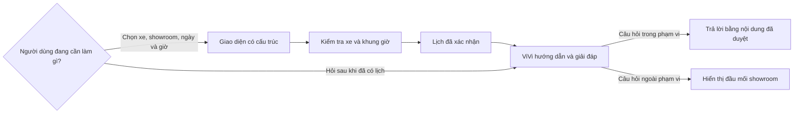
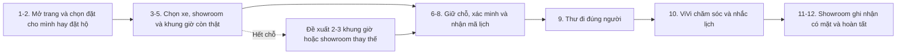
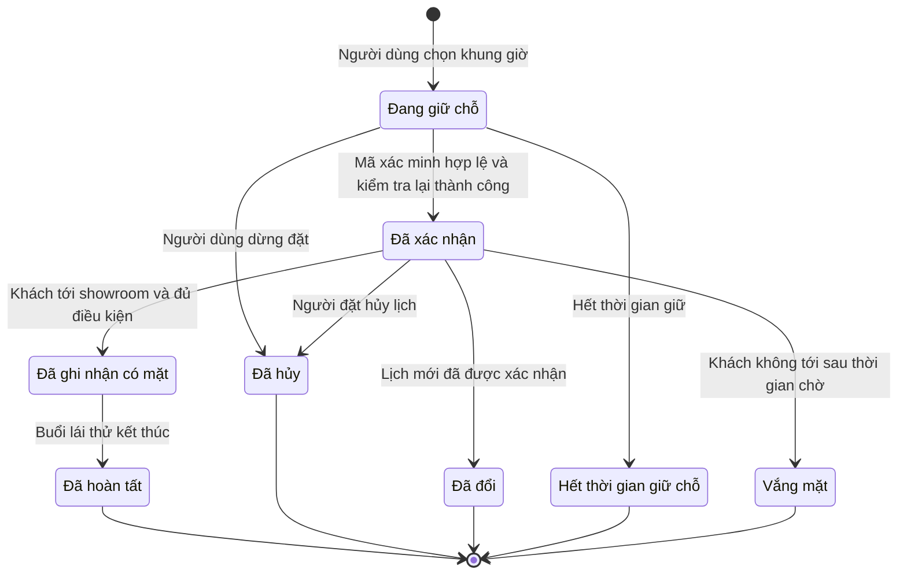
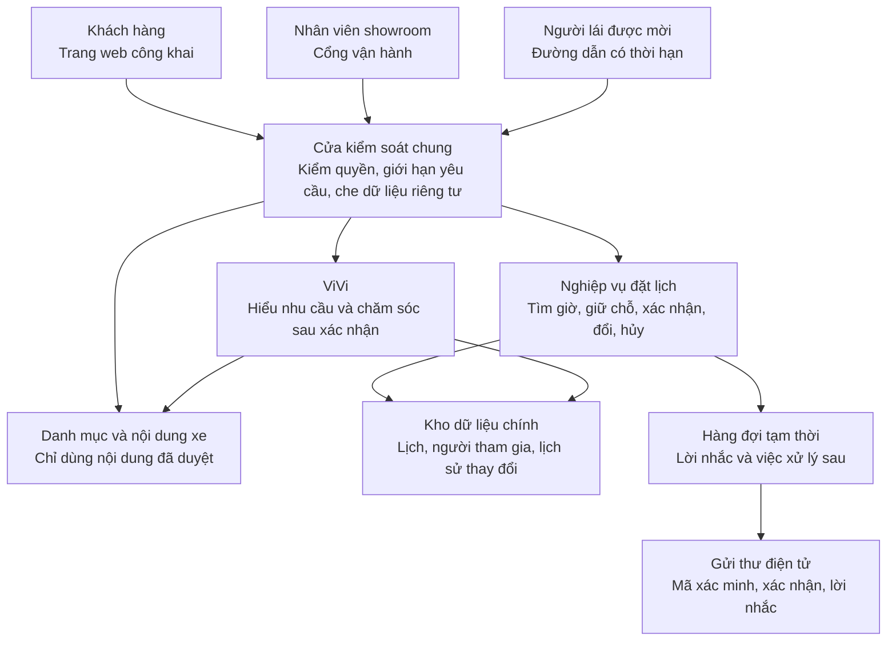
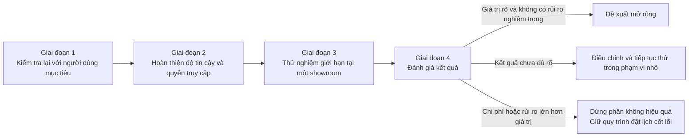

# ViVi - Nền tảng đặt lịch lái thử và chăm sóc sau đặt lịch

**Tài liệu yêu cầu sản phẩm chính thức**

- **Mã dự án:** P-053
- **Nhóm thực hiện:** Du lịch Hà Nội
- **Chương trình:** AI20K Build Phase
- **Phiên bản tài liệu:** 3.0 - Bản chính thức để nộp
- **Ngày hoàn tất:** 31/08/2026
- **Người phụ trách sản phẩm:** Hoàng Minh
- **Phạm vi tài liệu:** Trang giới thiệu xe, quy trình đặt và quản lý lịch, ViVi chăm sóc sau khi lịch được xác nhận, cùng cổng vận hành dành cho showroom.

---

## 0. Mục đích và cách đọc tài liệu

Đây là bản tài liệu yêu cầu sản phẩm chính thức của nhóm em. Tài liệu này thay thế bản 2.0 ngày 21/08/2026 và được dùng làm bản nộp cuối cùng. Nhóm em đã cập nhật tài liệu từ bản trình bày cuối, kết quả phỏng vấn, kết quả thử nghiệm giao diện, báo cáo kiểm tra hệ thống và trạng thái mã nguồn đến ngày 31/08/2026.

Việc tài liệu đã hoàn tất không có nghĩa là sản phẩm đã sẵn sàng mở cho khách hàng thật. Tài liệu đã chốt rõ vấn đề, người dùng, hướng giải quyết, phạm vi, yêu cầu và cách đo thành công. Những điều chưa được kiểm chứng bằng người dùng thật hoặc dữ liệu vận hành thật vẫn được nhóm em nêu rõ, vì việc thừa nhận giới hạn là một phần của bản nộp chính thức chứ không phải dấu hiệu của bản nháp.

Nhóm em ưu tiên dùng từ thông dụng trong toàn bộ tài liệu. Khi buộc phải nhắc đến một tên kỹ thuật, nhóm em giải thích ngay ý nghĩa của tên đó. Người đọc không cần biết lập trình vẫn có thể hiểu sản phẩm làm gì, vì sao nhóm em làm như vậy và điều kiện nào phải đạt trước khi thử nghiệm thực tế.

### 0.1 Những thay đổi quan trọng so với phiên bản 2.0

Phiên bản 2.0 đã xác định đúng hướng đặt lịch đáng tin cậy và chăm sóc sau đặt lịch, nhưng tài liệu vẫn mang tính rà soát nội bộ. Bản 3.0 đã được nhóm em hoàn thiện theo bốn thay đổi chính.

Thứ nhất, nhóm em bỏ trạng thái “bản nháp” và chuyển toàn bộ nội dung thành văn bản chính thức. Các đoạn viết tắt, câu thiếu chủ thể và bảng chứa quá nhiều thuật ngữ được thay bằng câu tiếng Việt đầy đủ.

Thứ hai, nhóm em bổ sung bối cảnh thị trường, dải sản phẩm VinFast, số liệu ngành, ba tình huống phỏng vấn và sáu phát hiện từ thử nghiệm giao diện. Mỗi số liệu đều đi kèm nguồn và giới hạn sử dụng.

Thứ ba, nhóm em chốt lại vai trò của ViVi. Phần đặt lịch dùng các trường lựa chọn rõ ràng vì xe, showroom, ngày và giờ là những dữ liệu cần chính xác. ViVi không thay biểu mẫu bằng một chuỗi câu hỏi dài. ViVi tạo giá trị chính sau khi lịch đã được xác nhận, khi người dùng cần chuẩn bị, cần được nhắc đúng lúc hoặc cần hỏi những thông tin khó tìm.

Thứ tư, nhóm em trình bày riêng kết quả của bộ tình huống đã biết và bộ tình huống hoàn toàn mới. Cách trình bày này ngăn việc hiểu sai rằng kết quả 100% trên một bộ kiểm tra đồng nghĩa với sản phẩm đã xử lý tốt mọi cách diễn đạt ngoài thực tế.

---

## 1. Tóm tắt dự án

Người đang cân nhắc mua xe không chỉ cần gửi được một yêu cầu lái thử. Họ cần biết chiếc xe muốn thử có thật sự sẵn sàng, showroom có nhận lịch hay chưa, khung giờ đã được giữ hay chưa và bước tiếp theo là gì. Nếu người dùng đặt hộ người khác, hệ thống còn phải phân biệt rõ ai là người đặt và ai là người trực tiếp lái.

Nhóm em xây dựng ViVi để giải quyết toàn bộ hành trình đó. Người dùng có thể xem xe, chọn đúng mẫu và phiên bản, chọn showroom, chọn khung giờ còn khả dụng, giữ chỗ, xác minh địa chỉ thư điện tử và nhận mã lịch ngay sau khi xác nhận thành công. Sau đó, ViVi giúp người dùng chuẩn bị cho buổi lái thử, trả lời bằng nội dung đã được kiểm tra, gửi lời nhắc đúng thời điểm và hướng dẫn người dùng tự đổi hoặc hủy lịch khi kế hoạch thay đổi.

Showroom sử dụng một cổng vận hành riêng để nhìn thấy cùng một trạng thái lịch với khách hàng. Nhân viên có thể biết xe nào đã được giữ, ai là người lái, ai phụ trách buổi hẹn và lịch đã được ghi nhận có mặt, hoàn tất hay vắng mặt. Cách làm này giúp giảm nguy cơ hai người cùng giữ một xe trong cùng khung giờ và giúp showroom đo được tỷ lệ khách thật sự đến.

Giá trị cốt lõi của sản phẩm không nằm ở số cuộc trò chuyện. Giá trị cốt lõi nằm ở mức độ chắc chắn mà sản phẩm tạo ra trong suốt hành trình. Vì vậy, nhóm em dùng **tỷ lệ khách có mặt tại buổi lái thử** làm thước đo quan trọng nhất. Nhóm em không dùng số tin nhắn hoặc độ dài cuộc trò chuyện làm thước đo thành công, vì người dùng nói chuyện nhiều hơn không có nghĩa là họ được phục vụ tốt hơn.

### 1.1 Tuyên bố định vị

Đối với người đang cân nhắc mua xe VinFast và showroom cần vận hành lịch lái thử, ViVi là nền tảng đặt lịch và chăm sóc sau đặt lịch. Khác với một biểu mẫu chỉ ghi nhận nhu cầu, ViVi kết nối việc đặt lịch với xe dùng để lái thử, khung giờ và nhân sự có thật. Khác với một khung trò chuyện hỏi lại từng trường thông tin, ViVi để người dùng chọn nhanh bằng giao diện rõ ràng và chỉ tham gia sâu khi người dùng cần được chuẩn bị hoặc giải đáp sau khi lịch đã được xác nhận.

### 1.2 Kết quả mà nhóm em hướng tới

Nhóm em muốn người dùng hoàn tất việc đặt lịch trong một hành trình dễ hiểu, nhận được xác nhận rõ ràng và biết chính xác mình phải làm gì tiếp theo. Nhóm em muốn người đặt hộ và người lái nhận đúng nội dung dành cho vai trò của mình. Nhóm em cũng muốn người dùng tự đổi hoặc hủy lịch mà không phải gọi điện và giải thích với nhân viên.

Đối với showroom, nhóm em muốn mỗi lịch chỉ có một người phụ trách liên hệ, mỗi xe chỉ được giữ cho một lịch trong cùng thời điểm và mọi lịch đã diễn ra đều được đóng lại bằng trạng thái hoàn tất hoặc vắng mặt. Khi các dữ liệu này đầy đủ, showroom mới có thể đánh giá đúng hiệu quả vận hành và tỷ lệ khách có mặt.

### 1.3 Tóm tắt vấn đề, giải pháp và kết quả mong đợi

| Vấn đề người dùng gặp phải | Cách sản phẩm giải quyết | Kết quả cần quan sát |
|---|---|---|
| Người dùng chọn được giờ nhưng chỉ nhận thông báo “đã tiếp nhận”. | Hệ thống giữ xe và khung giờ trước, sau đó xác nhận và sinh mã lịch ngay khi mọi điều kiện hợp lệ. | Người dùng nói đúng rằng lịch đã được xác nhận và biết mã lịch của mình. |
| Người dùng không biết mình đã hoàn tất hay còn phải chờ duyệt. | Trang web, thư điện tử, ViVi và cổng showroom dùng cùng tên trạng thái. | Người dùng hiểu đúng trạng thái và bước tiếp theo. |
| Người dùng muốn hủy nhưng ngại nhắn cho nhân viên để giải thích. | Nút quản lý lịch cho phép người đặt tự chọn đổi hoặc hủy. | Người dùng hoàn tất thao tác mà không cần cuộc gọi hỗ trợ. |
| Người đặt hộ và người lái bị gộp thành một người. | Hệ thống tạo hai hồ sơ, hai nội dung thư và hai phạm vi quyền khác nhau. | Thông tin đi đúng người và showroom tìm đúng người lái. |
| Sau khi đặt, người dùng rơi vào khoảng chờ thiếu hướng dẫn. | ViVi cung cấp danh sách chuẩn bị, lời nhắc và câu trả lời có nguồn sau khi lịch được xác nhận. | Người dùng chuẩn bị đủ và có khả năng đến hẹn cao hơn. |
| Showroom liên hệ trùng hoặc không đóng trạng thái sau buổi hẹn. | Mỗi lịch chỉ có một người phụ trách và cổng vận hành ghi nhận có mặt, hoàn tất hoặc vắng mặt. | Không có liên hệ trùng và dữ liệu tỷ lệ có mặt được ghi đầy đủ. |

---

## 2. Bối cảnh và cơ hội

### 2.1 VinFast có dải sản phẩm rộng và quyết định mua có giá trị lớn

Tại thời điểm khảo sát, VinFast có các dòng xe cá nhân gồm VF 3, VF 5, VF 6, VF 7, VF MPV 7, VF 8 và VF 9; các dòng Green gồm Minio, Nerio, Herio và Limo; cùng các sản phẩm thương mại gồm EC Van và EBus.

Nhóm em lưu và đối chiếu 14 trang sản phẩm chính thức trong tháng 08/2026. Khoảng cách giữa sản phẩm rẻ nhất và sản phẩm đắt nhất lớn hơn tám lần. Nerio Green, Herio Green và EBus chưa hiển thị giá trên các trang mà nhóm em khảo sát nên nhóm em không tự điền số liệu.

| Mẫu xe | Giá ghi nhận, triệu đồng | Nhóm sản phẩm |
|---|---:|---|
| Minio Green | 178,6 | Dòng Green |
| EC Van | 254,6 | Xe thương mại |
| VF 3 | 270,8 | Xe cá nhân |
| VF 5 | 471,2 | Xe cá nhân |
| VF 6 | 613,7 | Xe cá nhân |
| Limo Green | 664,1 | Dòng Green |
| VF 7 | 703,0 | Xe cá nhân |
| VF MPV 7 | 712,5 | Xe cá nhân |
| VF 8 | 853,1 | Xe cá nhân |
| VF 9 | 1.280,6 | Xe cá nhân |

Phiên bản cao nhất của VF 9 có giá 1.452,6 triệu đồng tại thời điểm khảo sát. Bảng trên giúp người đọc hình dung độ rộng của dải sản phẩm, không dùng thay cho bảng giá bán hàng.

Giá xe thay đổi theo chương trình bán hàng và từng thời điểm. Vì vậy, các con số trên chỉ mô tả bối cảnh tại ngày khảo sát, không phải bảng giá hiện hành. Trong sản phẩm thật, mọi thông tin về giá phải lấy từ nguồn chính thức còn hiệu lực hoặc phải nói rõ rằng hệ thống chưa thể xác nhận.

Một chiếc xe là quyết định có giá trị lớn, nên người mua thường tìm hiểu trong thời gian dài trước khi xuống tiền. Bản trình bày cuối của nhóm em dẫn nguồn tại Việt Nam cho thấy hành trình từ lúc bắt đầu tìm hiểu đến lúc chốt mua có thể kéo dài hai đến ba tháng, chưa tính thời gian chờ giao xe. Người mua thường đọc thông tin trên mạng trước khi đến showroom. Buổi lái thử vì thế là một bước quan trọng để người mua chuyển từ tìm hiểu sang trải nghiệm thật.

### 2.2 Số liệu ngành cho thấy vấn đề nằm ở vận hành lịch hẹn

Các báo cáo ngành ô tô nước ngoài được nhóm em dùng để nhận diện hướng của vấn đề.

| Chỉ số tham khảo | Kết quả được công bố | Ý nghĩa đối với dự án | Nguồn |
|---|---:|---|---|
| Khách có mặt với lịch lái thử đặt trực tuyến | 40% đến 50% | Việc tạo được lịch chưa bảo đảm khách sẽ tới. | Demand Local, 2026 |
| Tỷ lệ bỏ hẹn sau khi có xác nhận hai chiều tự động | 3% đến 7%, giảm từ 20% đến 30% | Xác nhận và nhắc đúng lúc là hướng can thiệp đáng thử. | Demand Local và AutoAlert |
| Khách phải chờ khi tới lái thử trong năm 2025 | 55%, tăng từ 41% năm 2024 | Lịch hẹn chỉ có giá trị khi showroom chuẩn bị đúng nguồn lực. | CDK Friction Points 2025 |
| Khách cho rằng buổi lái thử ảnh hưởng tới quyết định mua xe | 78% | Một lịch hẹn bị bỏ lỡ có thể làm mất cơ hội bán hàng. | CDK Test Drive Value |

Những con số trên chủ yếu đến từ thị trường Hoa Kỳ và không đại diện cho thị trường Việt Nam. Nhóm em không dùng chúng để dự báo doanh thu hoặc đặt mục tiêu tỷ lệ cho VinFast. Nhóm em chỉ dùng chúng để xác định một giả thuyết hợp lý: nếu lịch hẹn được xác nhận rõ ràng, xe được chuẩn bị đúng và người dùng được nhắc đúng lúc thì phần bỏ hẹn có thể giảm.

### 2.3 Khoảng trống tại Việt Nam

Tài liệu của dự án chưa có dữ liệu vận hành đủ tin cậy về số lịch được tạo, số lịch được xác nhận, số lịch bị hủy, số khách vắng mặt và số khách đã tới showroom trong một giai đoạn đủ dài tại Việt Nam. Vì vậy, nhóm em không đưa ra mức tăng doanh thu hoặc mức giảm bỏ hẹn khi chưa có số liệu gốc.

Khoảng trống dữ liệu này không làm mất đi vấn đề mà người dùng phản ánh. Nó chỉ giới hạn điều nhóm em được phép kết luận. Nhóm em có thể kết luận rằng sự không chắc chắn là một vấn đề có thật trong các cuộc phỏng vấn. Nhóm em chưa thể kết luận mức độ phổ biến của vấn đề trên toàn thị trường hoặc khẳng định ViVi sẽ làm tăng tỷ lệ có mặt bao nhiêu phần trăm trước khi chạy thử nghiệm thực tế.

---

## 3. Nghiên cứu người dùng

### 3.1 Cách nhóm em thực hiện nghiên cứu

Ngày 01/08/2026, nhóm em thực hiện ba cuộc phỏng vấn trực tiếp, mỗi cuộc kéo dài từ 22 đến 29 phút. Ba người tham gia đại diện cho ba tình huống khác nhau: một người mới có bằng lái và đang tìm hiểu chiếc xe đầu tiên, một người cân nhắc kỹ và từng bỏ một lịch hẹn, cùng một người vợ đặt lịch hộ chồng.

Ngày 14 và 15/08/2026, nhóm em tiếp tục thực hiện ba buổi thử nghiệm trên bản giao diện có độ hoàn thiện cao. Người tham gia vừa thao tác vừa nói ra suy nghĩ. Người điều phối chỉ quan sát và không gợi ý cách hoàn thành nhiệm vụ.

Mẫu nghiên cứu còn nhỏ. Hai người trong nhóm thử nghiệm giao diện làm công việc liên quan đến sản phẩm số, và không phải mọi người tham gia đều có nhu cầu lái thử xe trong thời gian gần. Vì vậy, kết quả nghiên cứu phù hợp để định hướng thiết kế nhưng chưa đủ để đại diện cho toàn bộ khách hàng VinFast. Trước khi mở thử nghiệm thực tế, nhóm em phải kiểm tra lại với ít nhất bảy người thật sự có ý định lái thử, trong đó có tối thiểu hai trường hợp đặt hộ.

### 3.2 Ba tình huống tiêu biểu

| Tình huống | Điều người dùng muốn đạt được | Điểm đau quan sát được | Yêu cầu rút ra cho sản phẩm |
|---|---|---|---|
| Người mới lái xe | Người dùng muốn cảm nhận không gian, vị trí ngồi và cách xe vận hành. | Người dùng không biết quy trình gồm bao nhiêu bước, showroom có đúng xe hay ai sẽ hỗ trợ. | Sản phẩm phải xác nhận rõ xe, thời gian, địa điểm và bước tiếp theo. |
| Người cân nhắc kỹ | Người dùng muốn có một buổi lái thử đúng kế hoạch và không phải chờ vô định. | Ý định tham gia giảm dần khi giờ hẹn không chắc chắn; các cuộc gọi lặp lại sau đó khiến người dùng tránh phản hồi. | Sản phẩm phải xác nhận lịch hai chiều, cho phép tự hủy và giới hạn việc liên hệ trùng. |
| Người đặt hộ | Người đặt muốn sắp xếp lịch cho người thân nhưng vẫn để người lái nhận đúng hướng dẫn. | Hệ thống chỉ có một hồ sơ nên showroom không tìm thấy người lái và mọi liên hệ dồn về người đặt. | Sản phẩm phải tách người đặt, người lái, nội dung thư và quyền thao tác ngay từ đầu. |

### 3.3 Ba phát hiện khiến nhóm em thay đổi hướng sản phẩm

Phát hiện thứ nhất là người dùng có thể bỏ hẹn không phải vì họ đột nhiên bận. Ý định của họ giảm dần khi mỗi bước đều thiếu xác nhận và không ai cho họ biết điều gì sẽ xảy ra tiếp theo.

Phát hiện thứ hai là nhiều người ngại chủ động hủy lịch vì họ phải nhắn cho một nhân viên và giải thích lý do. Im lặng dễ hơn. Vì vậy, một nút hủy rõ ràng có thể giúp showroom giải phóng xe và nhân sự sớm hơn so với việc cố giữ người dùng bằng cuộc gọi.

Phát hiện thứ ba là người đặt hộ và người lái có nhu cầu, thông tin và quyền khác nhau. Nếu hệ thống chỉ lưu một hồ sơ, thông báo sẽ đi sai người, showroom khó tìm lịch và dữ liệu riêng của người lái có thể bị chia sẻ không đúng chỗ.

Từ ba phát hiện này, nhóm em xác định vấn đề gốc như sau: **người dùng phải chờ đợi trong suốt hành trình đặt lịch nhưng không nhận được sự xác nhận chắc chắn về giờ, xe, người phụ trách và bước tiếp theo. Ý định tham gia vì thế giảm dần, và người dùng tự bảo vệ mình bằng cách im lặng.**

### 3.4 Sáu vấn đề trong bản giao diện cũ và cách nhóm em đã sửa

| Mã | Bản cũ khiến người dùng vướng ở đâu | Bản chính thức thay đổi như thế nào |
|---|---|---|
| A1 | ViVi hỏi lần lượt từng trường nên thao tác có thể chậm hơn biểu mẫu. | Giao diện có cấu trúc xử lý phần nhập nhanh; ViVi tập trung vào chăm sóc sau xác nhận. |
| B2 | Sau khi bấm xác nhận, người dùng không biết đã hoàn tất hay còn phải chờ duyệt. | Màn hình thành công hiển thị trạng thái, mã lịch, xe, showroom, thời gian và bước tiếp theo. |
| C1 | Tên và số điện thoại không nói rõ thuộc về người đặt hay người lái. | Hệ thống hỏi “Bạn đặt cho mình hay đặt hộ?” ngay từ đầu và tạo hai hồ sơ khi cần. |
| E1 | Người dùng không tìm thấy lối vào để xem lại lịch từ trang chủ. | Nút “Tra cứu và quản lý lịch” xuất hiện trên thanh điều hướng và phiếu xác nhận. |
| E2 | Người dùng muốn hủy nhưng luồng cũ lại dẫn tới đổi giờ. | Hai lựa chọn “Đổi lịch” và “Hủy lịch” nằm trong cùng một nơi, với hậu quả được giải thích rõ. |
| F1 | Danh mục xe bị đặt quá sâu sau nội dung thương hiệu. | Dải xe và nút đăng ký lái thử được đưa lên sớm hơn trong hành trình. |

Kết luận quan trọng nhất của vòng thử nghiệm là điểm đau của người dùng không nằm ở việc họ không biết điền biểu mẫu. Điểm đau nằm ở sự không chắc chắn sau khi đặt. Quyết định này trở thành nền tảng cho toàn bộ phạm vi sản phẩm ở các phần tiếp theo.

---

## 4. Người dùng và nhu cầu cần giải quyết

### 4.1 Những nhóm người dùng chính

| Nhóm người dùng | Nhu cầu chính | Quyền và giới hạn |
|---|---|---|
| Người tự đặt và tự lái | Người dùng cần tìm đúng xe, xác nhận nhanh và tự quản lý lịch. | Sau khi xác minh, người dùng được xem, đổi hoặc hủy lịch của chính mình. |
| Người đặt hộ | Người đặt cần nhập riêng thông tin của bản thân và người lái. | Người đặt được quản lý lịch nhưng không được xem hoặc sửa thông tin riêng mà người lái cung cấp cho ViVi. |
| Người lái được mời | Người lái cần xem lịch, danh sách chuẩn bị và hỏi về chiếc xe sắp lái. | Đường dẫn riêng không cho phép người lái đổi, hủy hoặc xem toàn bộ dữ liệu quản lý của người đặt. |
| Người dùng quay lại | Người dùng cần tìm, đổi hoặc hủy một lịch đã đặt. | Người dùng phải xác minh đúng địa chỉ thư điện tử trước khi xem lịch. |
| Nhân viên showroom | Nhân viên cần biết khách, xe và phần việc sắp tới. | Nhân viên chỉ được xem những lịch thuộc showroom hoặc phần việc đã được giao. |
| Quản lý showroom | Quản lý cần theo dõi xe, nhân sự, lịch trùng và tình trạng khách có mặt. | Quản lý chỉ thao tác trong showroom của mình; mọi thay đổi phải có lịch sử. |
| Người phụ trách nội dung | Người phụ trách cần kiểm tra thông tin trước khi ViVi sử dụng. | Nội dung chưa duyệt hoặc hết hiệu lực không được dùng để trả lời khách hàng. |

### 4.2 Năm việc người dùng cần sản phẩm làm giúp

Thứ nhất, người dùng cần **bắt đầu đúng chỗ**. Khi đang xem một mẫu xe, họ phải thấy ngay cách đặt lịch cho mẫu đó mà không phải tìm lại từ đầu.

Thứ hai, người dùng cần **đặt một lịch có thật**. Họ phải biết xe, showroom, khung giờ và người hỗ trợ có khả năng phục vụ trước khi nhận mã xác nhận.

Thứ ba, người dùng cần **đặt hộ đúng người**. Hệ thống phải tách thông tin và thông báo của người đặt với người lái để mỗi người chỉ nhận phần liên quan tới mình.

Thứ tư, người dùng cần **chuẩn bị sau khi được xác nhận**. Họ phải biết cần mang gì, đi đâu, buổi lái thử dự kiến diễn ra như thế nào và ai sẽ hỗ trợ.

Thứ năm, người dùng cần **đổi hoặc hủy lịch mà không phải gọi điện**. Thao tác phải an toàn, dễ tìm và giúp showroom giải phóng xe cùng khung giờ ngay khi việc hủy hoàn tất.

### 4.3 Nhu cầu của showroom

Showroom cần một nguồn thông tin chung cho cả khách hàng và nhân viên. Khi khách nhìn thấy lịch “đã xác nhận”, cổng showroom cũng phải nhìn thấy đúng lịch đó. Khi khách hủy hoặc đổi, xe và khung giờ cũ phải được trả lại cho showroom và các lời nhắc cũ phải dừng.

Showroom cũng cần giảm các cuộc gọi dò thông tin. ViVi có thể hỏi đúng người, gom câu trả lời thành bản tóm tắt và ghi rõ thông tin nào do người đặt cung cấp, thông tin nào do người lái tự xác nhận, cùng thông tin nào vẫn phải hỏi tại quầy. Mỗi lịch chỉ có một người phụ trách liên hệ để tránh việc hai nhân viên gọi cùng một khách.

---

## 5. Hướng giải quyết của sản phẩm

### 5.1 Nhóm em không dùng hội thoại để thay thế biểu mẫu

VinFast đã có biểu mẫu đăng ký lái thử trên trang web. Nếu mục tiêu chỉ là giúp khách gửi yêu cầu mà không gọi cho nhân viên bán hàng, cách đơn giản nhất là kết nối biểu mẫu đó với xe dùng để lái thử và lịch nhân sự. Việc thêm một khung trò chuyện hỏi lại tên, số điện thoại, mẫu xe, showroom và thời gian không tự tạo thêm giá trị. Cách đó còn có thể làm người dùng mất nhiều thời gian hơn và tạo thêm rủi ro hiểu sai.

Vì vậy, nhóm em chốt rằng bản đầu tiên dùng giao diện có cấu trúc để đặt lịch. Người dùng nhìn thấy các lựa chọn cùng lúc, chọn nhanh bằng nút bấm và kiểm tra lại toàn bộ thông tin trước khi xác nhận. ViVi không tranh phần việc này với biểu mẫu.

Khoảng trống thật sự bắt đầu sau khi người dùng bấm xác nhận và kéo dài cho tới lúc họ bước vào showroom. Trong khoảng thời gian đó, người dùng cần biết lịch đã chắc chắn hay chưa, phải mang gì, đi đâu, lái trong bao lâu, quy trình tại showroom diễn ra như thế nào và ai sẽ hỗ trợ. Đây là phần ViVi đảm nhận.

### 5.2 Mục tiêu của phiên bản hiện tại

Nhóm em đặt ra sáu mục tiêu cho phiên bản hiện tại.

1. Nhóm em phải bảo đảm rằng xe và khung giờ hiển thị cho người dùng là những lựa chọn hệ thống có thể phục vụ.

2. Nhóm em phải phân biệt rõ “đang giữ chỗ” với “đã xác nhận” trên trang web, trong thư điện tử, trong ViVi và trên cổng showroom.

3. Nhóm em phải tách người đặt với người lái để thông tin, lời nhắc và quyền thao tác đi đúng người.

4. Nhóm em phải cho phép người đặt tự tra cứu, đổi và hủy lịch sau khi xác minh danh tính.

5. Nhóm em phải giúp người dùng chuẩn bị sau khi lịch được xác nhận bằng danh sách việc cần làm, lời nhắc và câu trả lời có nguồn.

6. Nhóm em phải giúp showroom đóng đúng trạng thái của mỗi lịch để đo được khách có đến hay không.

### 5.3 Các nguyên tắc xuyên suốt

**Trạng thái thật luôn quan trọng hơn câu chữ.** ViVi, trang web và thư điện tử chỉ được nói “đã xác nhận” khi hệ thống đã giữ thành công xe, khung giờ và nhân sự cần thiết. Câu chữ không được tạo cảm giác chắc chắn hơn dữ liệu thật.

**Dữ liệu cần chính xác phải dùng lựa chọn rõ ràng.** Mẫu xe, phiên bản, showroom, ngày, giờ, người đặt và người lái phải được chọn hoặc nhập trong các trường riêng. ViVi được dùng để giải thích và hỗ trợ, không được tự đoán những dữ liệu này rồi âm thầm tạo lịch.

**Mọi nơi cùng đọc một nguồn thông tin.** Khách hàng, ViVi, thư điện tử và showroom phải thấy cùng một mã lịch, cùng một thời gian và cùng một trạng thái.

**Hệ thống chỉ thu dữ liệu thật sự cần thiết.** Phiên bản hiện tại không yêu cầu tải ảnh hoặc nhập số giấy phép lái xe. Nhân viên kiểm tra giấy phép bản gốc tại quầy trước khi cho khách lái thử.

**Người đặt và người lái là hai người riêng biệt.** Hệ thống không tự chuyển quyền quản lý lịch hoặc thông tin riêng từ người này sang người kia.

**ViVi phải nói rõ khi chưa biết.** Nếu thông tin chưa được duyệt, đã hết hiệu lực hoặc cần dữ liệu cập nhật theo thời gian, ViVi phải nói rằng chưa thể xác nhận và chỉ người dùng tới đầu mối của showroom.

**Lỗi ở một phần không được làm hỏng toàn bộ hành trình.** Nếu ViVi tạm thời không hoạt động, người dùng vẫn phải xem xe, chọn giờ, giữ chỗ, xác nhận, đổi hoặc hủy lịch bằng các nút bấm. Nếu hệ thống đặt lịch tạm lỗi, nội dung giới thiệu xe vẫn phải xem được và phải hiển thị thông báo rõ ràng.

**Thư điện tử là kênh duy nhất trong phạm vi hiện tại.** Nhóm em dùng thư điện tử để gửi mã xác minh, phiếu xác nhận, đường dẫn dành cho người lái và lời nhắc. Nhóm em không tuyên bố đã hỗ trợ Zalo hoặc tin nhắn điện thoại trong phiên bản này.

---

## 6. Trải nghiệm hoàn chỉnh của người dùng

### 6.1 Quy trình đặt lịch gồm mười hai bước

Sơ đồ dưới đây nhóm mười hai bước thành sáu chặng để người đọc nắm nhanh toàn bộ hành trình trước khi xem mô tả chi tiết.

1. Người dùng mở trang đặt lịch ngay trên trang web. Người dùng không phải cài thêm ứng dụng và không phải gọi điện để bắt đầu.

2. Hệ thống hỏi ngay từ đầu rằng người dùng đặt cho bản thân hay đặt hộ người khác. Câu trả lời này quyết định cách hệ thống thu thông tin và gửi thông báo ở các bước sau.

3. Người dùng chọn mẫu xe và phiên bản muốn lái thử. Hệ thống không tự thay bằng một phiên bản tương đương nếu chưa có quy tắc và sự đồng ý rõ ràng.

4. Người dùng chọn showroom. Kết quả phải có vị trí trên bản đồ, khoảng cách và lý do một showroom được xếp trước, chẳng hạn showroom gần hơn hoặc có khung giờ sớm hơn.

5. Người dùng chọn một khung giờ còn khả dụng. Hệ thống đối chiếu xe dùng để lái thử và khả năng phục vụ của nhân sự trước khi hiển thị lựa chọn.

6. Khi người dùng chọn giờ, hệ thống giữ chỗ trong một khoảng thời gian có đếm ngược. Màn hình phải nói rõ đây mới là bước giữ chỗ và lịch chưa được xác nhận.

7. Người đặt nhận một mã xác minh qua thư điện tử. Hệ thống dùng bước này để kiểm tra người thực hiện đặt lịch có quyền dùng địa chỉ thư đó.

8. Sau khi mã xác minh hợp lệ, hệ thống kiểm tra lại xe, khung giờ và thông tin người tham gia. Chỉ khi tất cả điều kiện vẫn đúng, hệ thống mới chuyển lịch sang trạng thái đã xác nhận và sinh mã lịch.

9. Người đặt nhận phiếu xác nhận. Nếu người lái là một người khác, người lái nhận một thư riêng với đường dẫn chỉ dành cho việc chuẩn bị. Hai người không nhận cùng một nội dung sao chép nguyên bản.

10. ViVi bắt đầu chăm sóc sau khi lịch đã được xác nhận. ViVi hiển thị danh sách cần chuẩn bị, trả lời câu hỏi trong phạm vi đã duyệt và gửi lời nhắc trước 24 giờ cùng trước 2 giờ.

11. Khi người lái tới showroom, nhân viên đối chiếu mã lịch, danh tính người lái và giấy phép lái xe bản gốc. Hệ thống chỉ ghi nhận khách có mặt khi các điều kiện cần thiết đã được xác nhận.

12. Sau buổi hẹn, showroom đóng lịch bằng trạng thái hoàn tất hoặc vắng mặt. Dữ liệu này được dùng để tính tỷ lệ khách có mặt.

### 6.2 Cách xử lý khi khung giờ đã hết

Khi khung giờ người dùng chọn không còn khả dụng, hệ thống không chỉ hiển thị một câu xin lỗi. Hệ thống phải đề xuất từ hai đến ba lựa chọn thay thế gắn với xe có thật. Lựa chọn thay thế có thể lệch khoảng ba mươi phút đến một giờ hoặc thuộc một showroom gần đó. Người dùng xem rõ sự khác biệt trước khi chọn và quay lại bước giữ chỗ.

### 6.3 Các trạng thái mà người dùng nhìn thấy

**Đang giữ chỗ** có nghĩa là hệ thống đang tạm giữ xe và khung giờ để người dùng hoàn tất thông tin. Lịch chưa được xác nhận, chưa có mã lịch chính thức và chưa bắt đầu chăm sóc. Màn hình phải có thời gian còn lại và cách chọn lại nếu thời gian giữ chỗ kết thúc.

**Đã xác nhận** có nghĩa là hệ thống đã kiểm tra lại điều kiện phục vụ, đã tạo mã lịch và đã gửi phiếu xác nhận. ViVi chỉ bắt đầu chăm sóc ở trạng thái này.

**Đã ghi nhận có mặt** có nghĩa là showroom đã đối chiếu đúng người lái và giấy phép lái xe bản gốc tại quầy. Trạng thái này chứng minh khách đã tới showroom.

**Đã hoàn tất** có nghĩa là buổi lái thử đã kết thúc. Phiên bản hiện tại không tiếp tục tự động chăm sóc bán hàng sau trạng thái này.

**Đã hủy** có nghĩa là lịch không còn hiệu lực, lời nhắc phải dừng và xe cùng khung giờ phải được trả lại cho showroom.

**Đã đổi** có nghĩa là lịch cũ đã được thay bằng một lịch mới. Lịch cũ không tiếp tục gửi lời nhắc hoặc cho phép chăm sóc. Người dùng được dẫn tới mã lịch mới.

**Hết thời gian giữ chỗ** có nghĩa là người dùng chưa xác nhận trong thời gian cho phép. Hệ thống trả lại khung giờ và mời người dùng chọn một lựa chọn mới mà không trình bày nhầm rằng lịch đã bị hủy sau khi xác nhận.

**Vắng mặt** có nghĩa là thời gian hẹn đã qua nhưng showroom không ghi nhận khách có mặt. Nhân viên chỉ được đánh dấu trạng thái này sau khoảng thời gian chờ đã được quy định.

### 6.4 Trường hợp người đặt và người lái là hai người

Khi người dùng chọn “đặt hộ”, hệ thống tạo hai phần thông tin riêng. Người đặt cung cấp tên và địa chỉ thư điện tử để xác minh và quản lý lịch. Người lái cung cấp tên cùng địa chỉ thư điện tử cần thiết để nhận hướng dẫn chuẩn bị. Hệ thống giải thích mục đích của từng thông tin trước khi người dùng gửi.

Người đặt nhận phiếu xác nhận, mã lịch và đường dẫn quản lý. Người lái nhận đường dẫn riêng để xem lịch liên quan tới mình, xem danh sách cần chuẩn bị và trò chuyện với ViVi. Người lái không thể dùng đường dẫn đó để đổi hoặc hủy lịch. Nếu cần thay đổi, người lái liên hệ người đặt hoặc dùng đầu mối showroom được hiển thị.

Nếu lịch bị hủy hoặc đổi, đường dẫn cũ của người lái phải hết hiệu lực. Hệ thống chỉ gửi đường dẫn mới khi lịch mới đã được xác nhận và người lái vẫn là người tham gia.

| Khả năng | Người đặt | Người lái được mời | Nhân viên showroom |
|---|:---:|:---:|:---:|
| Xem thông tin cần thiết của lịch | Có | Có, trong phạm vi chuẩn bị | Có, khi lịch thuộc phạm vi công việc |
| Đổi hoặc hủy lịch | Có, sau khi xác minh | Không | Chỉ theo quy trình và quyền được giao |
| Nhận phiếu xác nhận | Có | Nhận thư riêng dành cho người lái | Xem lịch trên cổng vận hành |
| Trò chuyện với ViVi sau xác nhận | Có | Có | Không dùng ViVi thay cho cổng vận hành |
| Xem thông tin riêng của người còn lại | Chỉ phần tối thiểu của lịch | Không | Chỉ phần cần thiết và đã được che bớt |

### 6.5 ViVi chăm sóc sau khi lịch được xác nhận

ViVi bắt đầu bằng việc nói rõ lịch đã được xác nhận và tóm tắt mã lịch, mẫu xe, showroom, ngày cùng giờ. Sau đó, ViVi đưa ra các việc người dùng thường cần làm như xem đường đi, kiểm tra giấy tờ phải mang, xem thời lượng dự kiến, tìm hiểu quy trình tại showroom hoặc khám phá những điểm nên trải nghiệm trên mẫu xe đã đặt.

Trong mỗi lượt trao đổi, ViVi phải trả lời phần có thể trả lời trước. Nếu còn thiếu thông tin, ViVi chỉ hỏi thêm tối đa một câu có liên quan trực tiếp. ViVi không được biến cuộc trò chuyện thành một cuộc phỏng vấn dài chỉ để làm đầy hồ sơ.

ViVi chỉ trả lời bằng nội dung đã được người phụ trách duyệt hoặc bằng dữ liệu trực tiếp từ lịch đã xác nhận. Các câu hỏi về khuyến mãi đang thay đổi, giá lăn bánh, vay, bảo hiểm, đàm phán hoặc cam kết mua bán nằm ngoài phạm vi. Khi gặp những câu hỏi này, ViVi nói rõ giới hạn và hiển thị thông tin liên hệ của showroom.

ViVi không tự tạo yêu cầu chuyển tiếp cho nhân viên trong phiên bản hiện tại. Cách làm này giữ đúng phạm vi mà nhóm em đã chốt trong bản trình bày cuối. Người dùng luôn nhìn thấy địa chỉ, thư điện tử hoặc số điện thoại chính thức của showroom để chủ động liên hệ khi cần.

### 6.6 ViVi hỏi đúng người và tạo bản tóm tắt có nguồn

Nhóm em chia thông tin sau đặt lịch thành ba loại để ViVi hỏi đúng người và không thu thập quá mức cần thiết.

| Loại thông tin | Ví dụ | ViVi lấy thông tin từ đâu | Cách ghi trong bản tóm tắt |
|---|---|---|---|
| Lời dặn chung | Giấy phép bản gốc, thời điểm nên tới, địa chỉ showroom | ViVi dùng nội dung đã duyệt và không hỏi người dùng. | Hệ thống ghi rõ đây là hướng dẫn chính thức. |
| Thông tin hậu cần | Người đi cùng, nhu cầu đổi giờ, ghi chú khi tới nơi | ViVi hỏi người đặt vì người này quản lý lịch. | Hệ thống ghi “Người đặt cung cấp”. |
| Sở thích trải nghiệm | Không gian cho trẻ em, cảm giác lái, khả năng sạc | ViVi chỉ hỏi chính người lái qua đường dẫn riêng. | Hệ thống ghi “Người lái tự xác nhận”. |

Khi tạo bản tóm tắt cho nhân viên, mỗi dòng phải ghi rõ một trong ba nguồn: người đặt cung cấp, người lái tự xác nhận, hoặc chưa có và cần hỏi tại quầy. Nhân viên nhờ đó biết thông tin nào chắc chắn và thông tin nào không được tự suy diễn.

---

## 7. Yêu cầu chi tiết của sản phẩm

Bảng dưới đây giúp người đọc tra nhanh chín nhóm yêu cầu. Các mục 7.1 đến 7.9 giải thích chi tiết cách từng nhóm yêu cầu phải hoạt động.

| Nhóm yêu cầu | Điều bắt buộc phải bảo đảm | Bằng chứng dùng để nghiệm thu |
|---|---|---|
| Trang giới thiệu xe | Người dùng thấy đúng xe, nguồn nội dung và lối vào đặt lịch. | Kiểm tra nội dung, giao diện trên nhiều kích thước và thử nghiệm với người dùng. |
| Xe, showroom và khung giờ | Hệ thống chỉ hiển thị nguồn lực có thể phục vụ và không tạo lịch trùng. | Kiểm tra dữ liệu showroom và tình huống hai người cùng giữ một xe. |
| Xác minh và xác nhận | Mã xác minh chỉ mở đúng lịch; mã lịch chỉ được tạo sau khi kiểm tra lại thành công. | Kiểm tra mã sai, hết hạn, dùng lại và gửi yêu cầu lặp. |
| Màn hình thành công và thư | Mọi kênh hiển thị cùng trạng thái, xe, nơi, giờ và bước tiếp theo. | Người thử nói đúng trạng thái; nội dung thư khớp với dữ liệu lịch. |
| Tra cứu, đổi và hủy | Người đặt tự thao tác an toàn; lịch cũ chỉ đóng sau khi lịch mới được xác nhận. | Thử nghiệm đầy đủ các tình huống thành công, hết chỗ và mất kết nối. |
| Chăm sóc và lời nhắc | ViVi chủ động hướng dẫn, dùng nội dung đã duyệt và không gửi lời nhắc cho lịch đã đóng. | Kiểm tra nội dung, nguồn, thời điểm gửi và trường hợp hủy sát lúc gửi. |
| Cổng showroom | Nhân viên chỉ thao tác trong phạm vi và đóng đúng trạng thái sau buổi hẹn. | Kiểm tra quyền, lịch sử thay đổi và diễn tập vận hành. |
| Dữ liệu và quyền riêng tư | Hệ thống thu tối thiểu, tách người đặt với người lái và che dữ liệu trong nhật ký. | Kiểm tra truy cập trái quyền, xuất hoặc xóa dữ liệu và rà soát nhật ký. |
| Khả năng sử dụng | Các hành trình chính dùng được trên nhiều thiết bị, bằng bàn phím và phần mềm hỗ trợ. | Kiểm tra tự động kết hợp kiểm tra thủ công với người dùng. |

### 7.1 Trang giới thiệu xe và điểm bắt đầu đặt lịch

Trang chủ phải đưa danh mục xe và nút đăng ký lái thử lên đủ sớm để người đang xem xe không phải đi qua nhiều phần nội dung thương hiệu. Mỗi trang chi tiết xe phải có một nút đặt lịch rõ ràng và phải chuyển đúng mẫu xe người dùng đang xem sang hành trình đặt lịch.

Thông tin về giá, bảo hành, sạc, tính năng hỗ trợ lái và chính sách phải có nguồn, ngày hiệu lực và người chịu trách nhiệm duyệt. Nếu nguồn chưa có hoặc đã hết hiệu lực, hệ thống phải ẩn thông tin hoặc nói rõ chưa thể xác nhận. Hệ thống không được giữ một con số cũ chỉ để tránh chỗ trống.

Kết quả showroom phải cho người dùng biết khoảng cách, vị trí và khung giờ sớm nhất. Nếu hệ thống xếp một showroom lên trước, giao diện phải giải thích lý do bằng từ ngữ dễ hiểu.

Trang giới thiệu xe vẫn phải hoạt động khi phần đặt lịch hoặc ViVi tạm thời gặp lỗi. Giao diện phải hiển thị đúng phần đang tạm ngưng và không chặn người dùng xem nội dung còn lại.

### 7.2 Chọn xe, showroom và khung giờ

Hệ thống chỉ hiển thị khung giờ mà xe dùng để lái thử và khả năng phục vụ của showroom đáp ứng được. Trang web của khách hàng và cổng showroom phải sử dụng cùng một nguồn dữ liệu về xe cùng khung giờ.

Hệ thống phải giữ đúng mẫu xe và phiên bản mà người dùng đã chọn. Nếu showroom chỉ có một xe tương đương, sản phẩm không được âm thầm thay thế. Sự thay thế chỉ được thực hiện khi quy tắc vận hành đã được duyệt và người dùng đồng ý rõ ràng.

Khi hai người cùng chọn một xe trong cùng khung giờ, hệ thống chỉ được cho một người giữ chỗ thành công. Người còn lại phải nhận được lựa chọn thay thế, không được nhận một mã lịch trùng.

Thời gian giữ chỗ phải lấy từ hệ thống, không lấy từ đồng hồ riêng trên thiết bị của người dùng. Khi người dùng tải lại trang, giao diện phải kiểm tra trạng thái mới nhất trước khi tiếp tục đếm ngược.

### 7.3 Xác minh và xác nhận lịch

Mã xác minh phải được gửi tới địa chỉ thư điện tử của người đặt. Giao diện phải che một phần địa chỉ, nói rõ thời gian có hiệu lực và cho biết khi nào người dùng được xin gửi lại.

Hệ thống phải từ chối mã sai, mã đã hết hạn, mã đã dùng hoặc quá nhiều lần nhập sai. Việc xác minh thành công chỉ cấp quyền cho đúng lịch, đúng người đặt và đúng hành động. Mã của một người không được dùng để mở lịch của người khác.

Ngay trước khi xác nhận, hệ thống phải kiểm tra lại thời gian giữ chỗ, xe, showroom và khung giờ. Nếu một điều kiện đã thay đổi, hệ thống không tạo mã lịch và phải hướng dẫn người dùng chọn lại mà không làm mất những thông tin còn hợp lệ.

Khi mọi điều kiện đều đúng và người dùng bấm xác nhận, hệ thống chỉ tạo một mã lịch duy nhất. Nếu mạng chập chờn khiến yêu cầu được gửi lại, hệ thống phải trả về cùng kết quả thay vì tạo hai lịch hoặc gửi hai thư xác nhận.

### 7.4 Màn hình thành công và thư xác nhận

Màn hình thành công phải hiển thị trạng thái “Đã xác nhận”, mã lịch, mẫu xe và phiên bản, showroom, địa chỉ, bản đồ, ngày giờ, người đặt, người lái, danh sách cần chuẩn bị và nút quản lý lịch. Nếu chưa có tên người phụ trách, giao diện phải nói rõ thay vì hiển thị dữ liệu trống hoặc tự tạo tên.

Phiếu xác nhận gửi qua thư điện tử phải chứa cùng thông tin với màn hình thành công. Người đặt và người lái nhận hai nội dung khác nhau theo vai trò. Mọi đường dẫn trong thư phải có thời hạn phù hợp và ngừng hoạt động khi lịch bị hủy hoặc đổi.

Nhóm em chỉ hiển thị thời gian phản hồi của showroom khi quy định đó đã được người vận hành duyệt. Nếu chưa có cam kết, sản phẩm chỉ hiển thị giờ hoạt động và đầu mối liên hệ, không tự hứa rằng nhân viên sẽ gọi trong một khoảng thời gian cụ thể.

### 7.5 Tra cứu, đổi và hủy lịch

Nút “Tra cứu và quản lý lịch” phải xuất hiện trên thanh điều hướng và phiếu xác nhận. Người dùng không phải quay lại khung trò chuyện hoặc nhớ một đường dẫn ẩn.

Sau khi xác minh đúng địa chỉ thư điện tử, người đặt được xem những lịch thuộc quyền quản lý của mình. Hệ thống không được để lộ tên, thời gian hoặc showroom của người khác trước bước xác minh.

Khi người dùng đổi lịch, lịch cũ phải còn nguyên cho tới khi lịch mới được xác nhận. Nếu khung giờ mới hết chỗ hoặc mạng gặp lỗi, người dùng vẫn giữ lịch cũ. Chỉ sau khi lịch mới thành công, hệ thống mới đóng lịch cũ, dừng lời nhắc cũ và gửi phiếu xác nhận mới.

Khi người dùng hủy, giao diện phải hiển thị đúng lịch và hậu quả trước khi yêu cầu xác nhận lần cuối. Sau khi hủy thành công, hệ thống trả lại xe cùng khung giờ, dừng lời nhắc và đóng đường dẫn của người lái. Nếu người dùng bấm lại do mạng chậm, hệ thống vẫn chỉ hủy một lần.

### 7.6 Nội dung chăm sóc và lời nhắc

Ngay sau khi lịch được xác nhận, ViVi phải chủ động đưa danh sách việc cần chuẩn bị thay vì chờ người dùng tự nghĩ ra câu hỏi. Danh sách tối thiểu gồm mã lịch, ngày giờ, địa chỉ và đường đi, giấy tờ cần mang, thời lượng dự kiến, quy trình tại showroom, điểm nên trải nghiệm trên xe và đầu mối hỗ trợ.

Hệ thống gửi lời nhắc trước 24 giờ và trước 2 giờ nếu lịch vẫn còn hiệu lực. Mỗi lời nhắc phải kiểm tra trạng thái mới nhất ngay trước khi gửi. Lịch đã hủy, đã đổi, đã hoàn tất hoặc đã được ghi nhận vắng mặt không được tiếp tục nhận lời nhắc như một lịch sắp tới.

Mỗi lịch chỉ có một người phụ trách liên hệ. Hệ thống phải ngăn thư điện tử và quy trình của showroom gửi lặp cùng một nội dung trong một khoảng thời gian ngắn. Nhóm em đặt hai giới hạn bắt buộc: không lịch nào bị liên hệ trùng và không lịch nào có hơn một người đang chịu trách nhiệm liên hệ.

### 7.7 Cổng vận hành của showroom

Nhân viên chỉ được xem lịch thuộc showroom hoặc phần việc được giao. Quản lý showroom được xem và điều phối lịch trong showroom của mình. Người quản trị toàn hệ thống chỉ dùng quyền cao hơn cho những công việc thật sự cần thiết.

Cổng vận hành phải cho phép tìm theo mã lịch và đối chiếu tên người lái cùng thông tin liên hệ đã được che bớt. Nhân viên kiểm tra giấy phép lái xe bản gốc, tình trạng còn hiệu lực và điều kiện phù hợp trước khi ghi nhận khách có mặt. Hệ thống không thu ảnh hoặc số giấy phép trong phạm vi hiện tại.

Sau buổi hẹn, nhân viên phải chọn hoàn tất hoặc vắng mặt. Mọi thay đổi trạng thái phải ghi người thực hiện, thời điểm và lý do khi có ngoại lệ. Việc chỉ ẩn một nút trên màn hình không được xem là đủ để bảo vệ quyền; hệ thống phía sau vẫn phải kiểm tra quyền ở mỗi thao tác.

### 7.8 Bảo vệ dữ liệu và quyền riêng tư

Hệ thống chỉ thu tên, địa chỉ thư điện tử, số điện thoại khi thật sự cần cho vận hành và những ghi chú mà người dùng chủ động cung cấp. Hệ thống không lưu mã xác minh, mật khẩu, đường dẫn bí mật, vị trí chính xác, ảnh giấy phép lái xe hoặc dữ liệu tài chính trong phần ghi nhớ sở thích.

Thông tin của người đặt và người lái phải được lưu tách biệt. Việc hai người dùng chung địa chỉ thư điện tử hoặc số điện thoại không đủ để hệ thống tự kết luận họ là cùng một người.

Nếu ViVi ghi nhớ một sở thích để hỗ trợ buổi lái thử, hệ thống phải nói rõ lợi ích của việc ghi nhớ. Người dùng phải có cách xem, sửa hoặc yêu cầu xóa thông tin do mình cung cấp. ViVi không được trình bày một suy đoán như sự thật đã được người dùng xác nhận.

Nhật ký dùng để tìm lỗi phải che tên, địa chỉ thư điện tử, số điện thoại và đường dẫn bí mật. Dữ liệu dùng để đo hiệu quả chỉ cần mã ẩn danh, vai trò người dùng, trạng thái lịch, kết quả và thời gian xử lý.

### 7.9 Khả năng sử dụng và hỗ trợ tiếp cận

Ngôn ngữ trên giao diện phải ngắn, trực tiếp và nhất quán. Mỗi màn hình chỉ có một hành động chính nổi bật. Các nút “Giữ chỗ”, “Xác nhận”, “Đổi lịch” và “Hủy lịch” không được dùng màu hoặc vị trí khiến người dùng nhầm mục đích.

Người dùng phải hoàn thành được các hành trình chính bằng bàn phím. Nhãn trường nhập, thứ tự di chuyển, độ tương phản, thông báo lỗi và nội dung đọc bằng phần mềm hỗ trợ phải đáp ứng tiêu chuẩn tiếp cận phổ biến. Hoạt ảnh không được che nội dung chính và người dùng có thể chọn giảm chuyển động.

Trang công khai phải dùng được trên điện thoại nhỏ, máy tính bảng và máy tính. Nhóm em kiểm tra các độ rộng 360, 768, 1.024 và 1.440 điểm ảnh. Nội dung quan trọng không được bị cắt hoặc buộc người dùng cuộn ngang.

---

## 8. Hệ thống vận hành như thế nào

### 8.1 Ba lối vào phục vụ ba nhóm người dùng

Khách hàng sử dụng trang web công khai để xem xe, đặt lịch và quản lý lịch. Nhân viên showroom sử dụng một cổng riêng để xem công việc trong phạm vi được giao. Người lái được mời sử dụng một đường dẫn có thời hạn để xem nội dung chuẩn bị dành cho mình.

Cả ba lối vào đều đi qua một cửa kiểm soát chung. Cửa này kiểm tra người dùng có quyền thực hiện hành động hay không, ngăn việc gửi quá nhiều yêu cầu trong thời gian ngắn và ghi lại hoạt động sau khi đã che thông tin riêng tư.

### 8.2 Các phần chính bên trong hệ thống

Phần **nghiệp vụ đặt lịch** chịu trách nhiệm tìm khung giờ, giữ chỗ, xác minh, xác nhận, đổi và hủy. Đây là nơi quyết định lịch có thật hay không. Các nút bấm quan trọng đi thẳng tới phần này và không phụ thuộc vào khả năng trò chuyện của ViVi.

Phần **ViVi** chịu trách nhiệm hiểu nhu cầu, chọn đúng nhóm hỗ trợ và soạn câu trả lời trong phạm vi cho phép. ViVi không tự sửa dữ liệu đặt lịch nếu người dùng chưa xác nhận bằng một hành động rõ ràng.

Phần **danh mục xe** cung cấp thông tin về mẫu xe, phiên bản và nội dung đã được kiểm tra. Dữ liệu thường dùng có thể được lưu tạm để trang phản hồi nhanh hơn, nhưng bản lưu tạm không được ghi đè một thông tin mới hơn từ nguồn chính.

Phần **kho dữ liệu chính** lưu lịch hẹn, người tham gia, lịch sử thay đổi và mạch hội thoại cần thiết. Dữ liệu được lưu bền vững để người dùng không mất hành trình khi máy chủ khởi động lại.

Phần **hàng đợi tạm thời** giúp xử lý những việc có thể thực hiện sau, chẳng hạn cập nhật hồ sơ hoặc gửi lời nhắc. Nếu phần này tạm ngưng, việc đặt và quản lý lịch vẫn phải hoạt động. Hệ thống phải ghi nhận việc chưa xử lý để có thể làm lại, thay vì âm thầm làm mất dữ liệu.

Phần **gửi thư điện tử** gửi mã xác minh, phiếu xác nhận, đường dẫn cho người lái và lời nhắc. Trong phạm vi hiện tại, đây là kênh gửi thông báo duy nhất.

Trong mã nguồn, nhóm em sử dụng FastAPI làm khung tiếp nhận yêu cầu, PostgreSQL làm kho dữ liệu chính, Redis làm hàng đợi tạm thời và Gmail API làm kết nối gửi thư. Người đọc không cần biết cách dùng các công nghệ này; điều quan trọng là mỗi phần có một trách nhiệm riêng và có phương án xử lý khi một phần tạm thời gặp lỗi.

### 8.3 Năm bước kiểm soát một lượt trò chuyện

Trước hết, hệ thống kiểm tra nội dung người dùng gửi. Hệ thống giới hạn độ dài, chặn câu lệnh cố gắng thay đổi quy tắc và che những dữ liệu không nên đi sâu vào phần xử lý hội thoại.

Tiếp theo, hệ thống xác định người dùng đang muốn đặt lịch, chăm sóc sau đặt lịch, quản lý một lịch cũ hay hỏi ngoài phạm vi. Với cách nói rõ ràng, hệ thống ưu tiên các quy tắc đơn giản. Với cách nói khó hơn, ViVi mới tham gia phân tích.

Sau đó, yêu cầu được chuyển tới đúng nhóm chức năng. Nhóm đặt lịch có thể tìm giờ, giữ chỗ, cập nhật thông tin, gửi mã xác minh và xác nhận. Nhóm chăm sóc chỉ có thể tra nội dung đã duyệt và ghi nhận sở thích phù hợp. Hai nhóm không dùng chung toàn bộ quyền.

Mã nguồn vẫn có nhóm chức năng đặt lịch để xử lý các hành động nói trên, nhưng hành trình chính trên giao diện gọi những chức năng này bằng nút bấm và trường lựa chọn. ViVi không hỏi tuần tự từng trường để thay thế giao diện đã được nhóm em chốt.

Khi cần gọi một chức năng, ViVi chỉ được gọi những chức năng đã được liệt kê cho đúng nhóm công việc. Một lượt trao đổi được giới hạn tối đa tám vòng xử lý và ba lần gọi chức năng để tránh lặp vô hạn, phản hồi quá chậm hoặc phát sinh chi phí ngoài kiểm soát.

Cuối cùng, hệ thống kiểm tra câu trả lời trước khi gửi cho người dùng. Số điện thoại, mã bí mật và nội dung quá dài phải được che hoặc rút gọn. Câu trả lời không được chứa một trạng thái lịch khác với dữ liệu thật.

### 8.4 Cách hệ thống tiếp tục hoạt động khi ViVi gặp lỗi

Các nút chọn xe, giữ chỗ, nhập mã, xác nhận, đổi và hủy lịch hoạt động trực tiếp với phần nghiệp vụ đặt lịch. Vì vậy, ngay cả khi dịch vụ hội thoại hết hạn mức sử dụng hoặc phản hồi chậm, người dùng vẫn hoàn thành được các hành động có cấu trúc.

Nếu ViVi không thể trả lời, giao diện hiển thị danh sách chuẩn bị đã được duyệt và đầu mối showroom. Nếu kho nội dung không tìm thấy nguồn phù hợp, ViVi nói rằng chưa có thông tin thay vì tự tạo câu trả lời. Nếu việc gửi thư gặp lỗi, hệ thống lưu trạng thái chưa gửi, thử lại theo giới hạn và cảnh báo cho người vận hành.

---

## 9. Cách nhóm em đo thành công

### 9.1 Chỉ số quan trọng nhất

Nhóm em đo **tỷ lệ khách có mặt** bằng cách lấy số lịch đã ghi nhận có mặt chia cho tổng số lịch đã ghi nhận có mặt và số lịch được ghi nhận vắng mặt. Một chuỗi đổi lịch chỉ được tính một lần ở lịch mới nhất, vì đó mới là cuộc hẹn người dùng cần tham gia.

Nhóm em không đưa lịch đang giữ chỗ, lịch hết thời gian giữ, lịch thử nội bộ, lịch đã đổi cũ hoặc lịch bị hủy đúng hạn vào mẫu số. Lịch đã qua giờ nhưng showroom chưa đóng trạng thái phải được ghi là “chưa hoàn tất dữ liệu”. Nhóm em không công bố tỷ lệ có mặt nếu số lịch chưa được đóng trạng thái còn quá lớn.

Dự án chưa có số liệu gốc đủ tin cậy tại Việt Nam, nên tài liệu này không tự đặt một tỷ lệ tăng. Trước khi mở thử nghiệm, nhóm em cần thu dữ liệu của một giai đoạn trước đó hoặc thiết kế hai nhóm so sánh phù hợp. Chỉ sau khi có đủ số lịch và dữ liệu được đóng đầy đủ, nhóm em mới kết luận ViVi có làm tăng tỷ lệ có mặt hay không.

### 9.2 Các chỉ số hỗ trợ

| Nhóm chỉ số | Cách đo | Chỉ số giúp nhóm em trả lời điều gì? |
|---|---|---|
| Hoàn tất xác nhận | Nhóm em lấy số người đạt trạng thái đã xác nhận chia cho số người bắt đầu đặt. | Người dùng đang vướng ở chọn giờ, giữ chỗ hay mã xác minh? |
| Hiểu trạng thái | Người thử phải nói đúng trạng thái, bước tiếp theo và nơi quản lý lịch. | Màn hình thành công có tạo sự chắc chắn hay không? |
| Tự quản lý lịch | Nhóm em đo tỷ lệ tra cứu, đổi hoặc hủy thành công mà không cần gợi ý. | Sản phẩm có thật sự giảm phụ thuộc vào cuộc gọi hay không? |
| Sử dụng nội dung chăm sóc | Nhóm em đo tỷ lệ mở danh sách chuẩn bị và đường dẫn người lái. | Người dùng có tiếp cận phần hỗ trợ sau đặt lịch hay không? |
| An toàn và quyền | Nhóm em đếm lịch trùng, hành động trái quyền, lời nhắc gửi sai và liên hệ trùng. | Sản phẩm có giữ được các ranh giới bắt buộc hay không? |
| Vận hành showroom | Nhóm em đo thời gian gửi thư, phân công người phụ trách và đóng trạng thái. | Vấn đề nằm ở trải nghiệm khách hàng hay quy trình showroom? |

### 9.3 Kết quả kiểm tra trên 57 tình huống đã biết

Bộ kiểm tra chính gồm 57 tình huống mà nhóm em đã dùng trong quá trình phát triển. Mỗi tình huống được chạy độc lập ba lần, tạo ra 171 lượt. Cả 171 lượt đều hoàn thành đúng yêu cầu. Mức ổn định này cho thấy hệ thống không thay đổi kết quả thất thường trên những tình huống đã biết.

| Nội dung được kiểm tra | Kết quả | Phạm vi của kết quả |
|---|---:|---|
| Hoàn thành đúng tình huống | 57 trên 57; đạt đủ 171 trên 171 lượt qua ba lần chạy | Kết quả chỉ áp dụng cho bộ tình huống đã biết. |
| Xác định đúng mục đích | 57 trên 57 | Hệ thống chọn đúng nhóm việc cần xử lý. |
| Chọn đúng chức năng | 57 trên 57 | Kết quả gồm cả trường hợp không được gọi chức năng. |
| Đối chiếu khung giờ | 172 trên 172 khung giờ trong 11 tình huống | Khung giờ được so với dữ liệu và các lịch đang giữ chỗ. |
| Xung đột xe và khả năng nhân sự | Không ghi nhận lịch trùng trong các tình huống kiểm tra | Đây là kiểm tra có kiểm soát, chưa phải số liệu vận hành thật. |
| Quyền truy cập và mã xác minh | Không có vi phạm trong 8 tình huống | Bộ kiểm tra bao gồm mã hết hạn, dùng lại và truy cập chéo. |
| Thông tin trái nguồn hoặc sai ràng buộc | Không có vi phạm trong 76 điểm kiểm tra | Kết quả áp dụng cho 19 tình huống có kiểm tra nguồn. |
| Thời gian xử lý | 95% lượt hoàn tất trong không quá 11,96 giây tính theo ngưỡng trung bình | Ngưỡng từng lần nằm từ 10,38 đến 12,94 giây. |

Những con số trên chỉ chứng minh hệ thống ổn định với bộ tình huống đã biết. Chúng không phải tỷ lệ chuyển đổi của khách hàng thật và không chứng minh hệ thống hiểu được mọi cách nói ngoài thực tế.

### 9.4 Kết quả trên 30 tình huống hoàn toàn mới

Nhóm em còn dùng một bộ 30 tình huống được giữ kín trước lần chạy chính thức. Hệ thống hoàn thành 16 trên 30 tình huống, tương đương 53,33%. Kết quả theo nhóm cho thấy hệ thống đạt 3 trên 5 với cách diễn đạt mới, 2 trên 5 với lỗi gõ, 3 trên 5 với cách nói về thời gian, 4 trên 5 với tên showroom, 0 trên 5 với hội thoại nhiều lượt và 4 trên 5 khi một chức năng gặp lỗi.

| Nhóm tình huống hoàn toàn mới | Số tình huống đạt | Tỷ lệ đạt |
|---|---:|---:|
| Cách diễn đạt mới | 3 trên 5 | 60% |
| Lỗi gõ | 2 trên 5 | 40% |
| Cách nói về thời gian | 3 trên 5 | 60% |
| Tên showroom | 4 trên 5 | 80% |
| Hội thoại nhiều lượt | 0 trên 5 | 0% |
| Một chức năng gặp lỗi | 4 trên 5 | 80% |
| **Tổng cộng** | **16 trên 30** | **53,33%** |

Kết quả này cho thấy hệ thống còn yếu khi người dùng sửa yêu cầu qua nhiều lượt hoặc cung cấp dần showroom, ngày và giờ. Một số trường hợp cũng thất bại khi tên showroom bị viết khác hoặc có lỗi gõ. Nhóm em đã dùng các lỗi đó để cải thiện mã nguồn, nên bộ 30 tình huống này từ nay chỉ còn là mốc chẩn đoán. Lần đánh giá tiếp theo phải dùng một bộ tình huống mới, không được chạy lại bộ cũ rồi công bố như một kết quả hoàn toàn độc lập.

Nhóm em chưa công bố một điểm tổng hợp cho cả hai bộ vì số trường hợp được con người đánh giá chéo vẫn chưa đủ. Việc giữ riêng hai kết quả giúp người đọc thấy đúng cả điểm mạnh lẫn giới hạn của hệ thống.

### 9.5 Trạng thái bài kiểm tra mã nguồn

Ngày 31/08/2026, nhóm em chạy lại toàn bộ bài kiểm tra phía máy chủ trên nhánh hiện tại. Kết quả có 634 bài đạt và 5 bài được chủ động bỏ qua. Không có bài nào thất bại. Các cảnh báo còn lại chủ yếu liên quan đến cách dùng cũ của một số thư viện và cần được dọn dần, nhưng chúng không làm thay đổi kết quả kiểm tra.

Kết quả này cập nhật cho con số cũ trong bản 2.0. Tuy nhiên, bài kiểm tra mã nguồn đạt không thay thế thử nghiệm giao diện với người dùng, kiểm tra thư điện tử thật, kiểm tra trên trình duyệt và diễn tập vận hành tại showroom.

### 9.6 Ba điều kiện bắt buộc trước khi mở thử nghiệm thực tế

Điều kiện thứ nhất là nhóm em phải thử lại các hành trình quan trọng với ít nhất bảy người đang thật sự có ý định lái thử. Tối thiểu sáu trong bảy người phải tự đặt được lịch, nói đúng trạng thái và tìm được nơi đổi hoặc hủy mà không cần gợi ý. Không được có lỗi nghiêm trọng về quyền riêng tư hoặc an toàn.

Điều kiện thứ hai là mọi bài kiểm tra bắt buộc phải đạt, gồm kiểm tra phía máy chủ, giao diện khách hàng, cổng showroom, quyền truy cập, thư điện tử thật, khả năng dùng bằng bàn phím và các trường hợp hai người cùng giữ một xe. Những bài được bỏ qua phải có lý do và người chịu trách nhiệm rõ ràng.

Điều kiện thứ ba là kho nội dung dùng để trả lời khách hàng phải được người phụ trách duyệt. Tại thời điểm bản trình bày cuối được hoàn thành, chưa có bản ghi nào ở trạng thái đã duyệt. Nếu điều kiện này chưa hoàn tất, ViVi chỉ được hiển thị danh sách chuẩn bị cố định và đầu mối showroom, không được trả lời các thông tin sản phẩm dễ thay đổi.

---

## 10. Phạm vi của phiên bản hiện tại

### 10.1 Những phần có trong phạm vi

| Phần sản phẩm | Nội dung nằm trong phiên bản hiện tại |
|---|---|
| Khám phá xe | Sản phẩm có trang danh mục, trang chi tiết và lối vào đặt lịch từ mẫu xe đang xem. |
| Đặt lịch | Người dùng chọn đặt cho mình hoặc đặt hộ, sau đó chọn xe, phiên bản, showroom và khung giờ. |
| Xác nhận | Hệ thống giữ chỗ có đếm ngược, xác minh qua thư điện tử và chỉ sinh mã sau khi kiểm tra lại. |
| Sau xác nhận | Sản phẩm gửi phiếu xác nhận, đường dẫn người lái, danh sách chuẩn bị và lời nhắc. |
| Tự quản lý | Người đặt có thể tra cứu, đổi hoặc hủy lịch sau khi xác minh. |
| Vận hành showroom | Nhân viên kiểm tra giấy phép bản gốc, ghi nhận có mặt, hoàn tất hoặc vắng mặt và lưu lịch sử thay đổi. |
| Đo hiệu quả | Nhóm em đo tỷ lệ khách có mặt cùng các chỉ số an toàn, tự phục vụ và chất lượng vận hành. |

### 10.2 Những phần không có trong phạm vi

| Hạng mục ngoài phạm vi | Lý do nhóm em chưa thực hiện |
|---|---|
| Mua xe, đặt cọc, thanh toán và ký hợp đồng | Các giao dịch này cần quy trình pháp lý và tài chính riêng. |
| Vay, bảo hiểm, đổi xe cũ, đàm phán giá và hứa khuyến mãi | Các chức năng này cần nguồn dữ liệu cập nhật, đối tác và quy định riêng. |
| ViVi tư vấn chọn xe tổng quát trước khi đặt | Nghiên cứu cho thấy điểm đau rõ hơn nằm ở sự không chắc chắn sau khi đặt. |
| Hệ thống quản lý khách hàng đầy đủ và tự động bán hàng sau lái thử | Phiên bản hiện tại chỉ phục vụ hành trình tới khi buổi lái thử kết thúc. |
| Zalo và tin nhắn điện thoại | Thư điện tử là kênh duy nhất đã được chốt trong phạm vi hiện tại. |
| Lịch VIP, duyệt tay khung giờ và tự động chuyển cuộc trò chuyện cho nhân viên | Những nhánh này làm tăng độ phức tạp nhưng chưa có bằng chứng đủ mạnh về nhu cầu. |
| Đồng bộ lịch hai chiều | Sản phẩm chỉ có thể mở một sự kiện Google Calendar đơn giản; sản phẩm không gọi đây là đồng bộ. |
| Tải ảnh hoặc lưu số giấy phép lái xe | Showroom kiểm tra giấy phép bản gốc tại quầy để giảm dữ liệu nhạy cảm phải lưu. |
| Mở rộng trải nghiệm ba chiều hoặc video | Các phần này không giải quyết vấn đề gốc của việc đặt lịch. |

---

## 11. Điều kiện phụ thuộc và rủi ro

### 11.1 Những điều kiện sản phẩm cần có

| Điều kiện phụ thuộc | Bên chịu trách nhiệm | Điều phải hoàn tất trước thử nghiệm |
|---|---|---|
| Dữ liệu xe, khung giờ và nhân sự | Showroom và nhóm vận hành | Dữ liệu phải được kiểm tra đầu ngày và phải có người xử lý xung đột. |
| Hệ thống gửi thư | Nhóm hạ tầng và vận hành | Địa chỉ gửi phải đáng tin cậy, theo dõi được thư trả lại và đo được thời gian thư tới. |
| Kho nội dung | Người phụ trách nội dung | Mỗi nội dung phải được duyệt, có ngày xem lại và tự ngừng dùng khi hết hiệu lực. |
| Cổng vận hành | Showroom | Nhân viên phải được hướng dẫn và phải đóng trạng thái sau mỗi buổi hẹn. |

### 11.2 Rủi ro và cách giảm rủi ro

| Rủi ro | Mức ảnh hưởng | Cách nhóm em giảm rủi ro |
|---|---|---|
| Người dùng vẫn không tới dù đã được chăm sóc. | Cao đối với giá trị kinh doanh | Nhóm em đo theo nhóm người dùng và không mở rộng nếu dữ liệu không cho thấy giá trị. |
| Thư xác minh tới sau khi thời gian giữ chỗ kết thúc. | Cao đối với tỷ lệ xác nhận | Nhóm em đo thời gian gửi thật, điều chỉnh thời gian giữ và cho phép chọn lại mà không nhập lại từ đầu. |
| ViVi làm hành trình dài hoặc gây phiền. | Trung bình đối với trải nghiệm | Giao diện xử lý phần đặt lịch; ViVi chỉ hỏi thêm tối đa một câu liên quan trong mỗi lượt. |
| Dữ liệu xe và khung giờ không còn mới. | Rất cao đối với niềm tin | Hệ thống kiểm tra lại trước khi xác nhận và đưa lựa chọn thay thế khi có xung đột. |
| Người đặt và người lái bị trộn thông tin. | Rất cao đối với quyền riêng tư | Hệ thống tách vai trò, đường dẫn và quyền; địa chỉ liên hệ giống nhau không tự động gộp hai người. |
| ViVi trả lời sai dù tìm được đúng nguồn. | Cao đối với chất lượng | ViVi chỉ dùng nội dung đã duyệt, ghi nguồn và đưa lỗi thật vào bộ kiểm tra mới. |
| Showroom liên hệ lặp lại. | Cao đối với niềm tin | Mỗi lịch chỉ có một người phụ trách và mọi lời nhắc kiểm tra trạng thái trước khi gửi. |
| Chi phí hội thoại tăng ngoài dự kiến. | Trung bình đối với vận hành | Hệ thống giới hạn số vòng xử lý, số lần gọi chức năng và độ dài câu trả lời. |
| Hoạt ảnh hoặc cửa sổ nổi cản trở người dùng. | Cao đối với khả năng tiếp cận | Nhóm em kiểm tra bằng bàn phím, phần mềm đọc màn hình và chế độ giảm chuyển động. |

### 11.3 Cách xử lý sự cố nghiêm trọng

Nếu hệ thống để lộ dữ liệu, tạo lịch trùng trên diện rộng, cho phép hành động trái quyền hoặc gửi hàng loạt thông báo sai, nhóm em phải tắt ngay phần gây lỗi. Phần đặt lịch cốt lõi chỉ được tiếp tục nếu vẫn an toàn. Nhóm em phải ghi lại thời điểm, phạm vi ảnh hưởng, cách xử lý và người chịu trách nhiệm.

Mỗi sự cố phải trở thành một tình huống kiểm tra mới. Nhóm em không chỉ sửa câu chữ nếu nguyên nhân nằm ở quyền truy cập, trạng thái lịch hoặc dữ liệu showroom.

---

## 12. Kế hoạch hoàn thiện và mở thử nghiệm

Sơ đồ dưới đây thể hiện thứ tự bốn giai đoạn và ba hướng quyết định sau thử nghiệm. Nhóm em chỉ chuyển sang giai đoạn tiếp theo khi các điều kiện của giai đoạn trước đã được đáp ứng.

### 12.1 Giai đoạn một: kiểm tra lại với người dùng mục tiêu

Nhóm em hoàn thiện bản mẫu theo sáu thay đổi đã nêu, sau đó thử với ít nhất bảy người có ý định lái thử trong thời gian gần. Các nhiệm vụ gồm tự đặt lịch, đặt hộ, nói lại trạng thái, tìm phiếu xác nhận, đổi lịch và hủy lịch. Nhóm em sửa mọi điểm khiến người dùng hiểu sai trước khi mở cho khách thật.

### 12.2 Giai đoạn hai: hoàn thiện độ tin cậy và quyền truy cập

Nhóm kỹ thuật kiểm tra việc giữ chỗ, xác minh, xác nhận, đổi, hủy, đường dẫn người lái và quyền của cổng showroom. Nhóm em phải chứng minh rằng hai yêu cầu đồng thời không tạo lịch trùng và người dùng không thể xem hoặc sửa lịch của người khác.

Nhóm em cũng hoàn thiện các bài kiểm tra giao diện, khả năng tiếp cận, gửi thư thật và trường hợp một phần hệ thống tạm ngưng. Kho nội dung phải được duyệt trước khi ViVi được phép trả lời thông tin sản phẩm.

### 12.3 Giai đoạn ba: thử nghiệm giới hạn tại một showroom

Nhóm em chọn một showroom có người phụ trách, dữ liệu xe rõ ràng và đủ khả năng đóng trạng thái hằng ngày. Số người tham gia được giới hạn, bảng theo dõi được kiểm tra mỗi ngày và từng phần như ViVi, đường dẫn người lái hoặc ghi nhớ sở thích phải có cách tắt riêng.

Trong giai đoạn này, nhóm em theo dõi tỷ lệ xác nhận, mức độ hiểu trạng thái, tỷ lệ tự đổi hoặc hủy, tỷ lệ thư đến nơi, số sự cố quyền truy cập, số lịch trùng, số liên hệ lặp và tỷ lệ khách có mặt. Mọi sự cố nghiêm trọng phải được xử lý trước khi nhận thêm người dùng.

### 12.4 Giai đoạn bốn: quyết định mở rộng, điều chỉnh hoặc dừng

Sau khi có đủ dữ liệu, nhóm em cùng người phụ trách kinh doanh và showroom so sánh kết quả với giai đoạn trước. Nếu tỷ lệ khách có mặt, khả năng tự phục vụ và chất lượng vận hành được cải thiện mà không phát sinh rủi ro nghiêm trọng, nhóm em mới đề xuất mở rộng. Nếu kết quả chưa rõ, nhóm em tiếp tục thử trong phạm vi nhỏ. Nếu chi phí hoặc rủi ro lớn hơn giá trị, nhóm em dừng phần không hiệu quả và giữ lại quy trình đặt lịch cốt lõi.

### 12.5 Cách quay về trạng thái an toàn

ViVi, đường dẫn người lái và phần ghi nhớ sở thích phải được bật hoặc tắt riêng. Khi một phần bị tắt, người dùng vẫn xem phiếu xác nhận, danh sách chuẩn bị cố định, đầu mối showroom và các nút quản lý lịch.

Việc tắt một phần không được xóa lịch đã xác nhận hoặc làm mất quyền đổi và hủy. Các đường dẫn đã phát hành phải được thu hồi khi cần, và hàng đợi thư phải kiểm tra trạng thái mới nhất trước khi tiếp tục gửi.

---

## 13. Vai trò của các thành viên

| Thành viên | Vai trò chính | Trách nhiệm trong dự án |
|---|---|---|
| Hoàng Minh | Phụ trách sản phẩm và thiết kế trải nghiệm | Hoàng Minh tìm hiểu người dùng, viết tài liệu yêu cầu sản phẩm, thiết kế giao diện và trải nghiệm, xây dựng mẫu thư gửi khách và điều phối các vòng thử nghiệm. |
| Thiên Lộc | Phụ trách toàn bộ luồng kỹ thuật và triển khai | Thiên Lộc thiết kế cách các phần trong hệ thống phối hợp với nhau, xây dựng giao diện đặt lịch theo thời gian thực và thiết lập quy trình kiểm tra cùng triển khai trên hạ tầng trực tuyến. |
| Bình Nguyên | Phụ trách máy chủ và nghiệp vụ đặt lịch | Bình Nguyên xây dựng phần xử lý đặt lịch, mã xác minh qua thư điện tử, giới hạn số yêu cầu và quy trình sau đặt lịch dành cho người đặt cùng người lái được mời. |
| Hải Châu | Phụ trách độ an toàn, dữ liệu và đánh giá chất lượng | Hải Châu xây dựng các lớp bảo vệ cho ViVi, chuẩn bị dữ liệu, xây dựng bộ tình huống đánh giá chất lượng câu trả lời và phát triển phần quản trị phía máy chủ. |
| Ngô Đình Luân | Người hướng dẫn của nhóm | Anh Ngô Đình Luân hỗ trợ nhóm tại các mốc chọn người dùng mục tiêu, cắt bớt phạm vi, điều phối tiến độ và xem xét các hướng giải quyết mới. |

Nhóm em làm việc theo nhánh riêng trước khi gộp thay đổi và chạy kiểm tra tự động trước khi gộp. Mọi kết luận trong tài liệu phải truy được về một buổi phỏng vấn, một buổi thử nghiệm, một báo cáo kiểm tra hoặc một phần mã nguồn. Khi chưa có bằng chứng, nhóm em nói rõ điều đó và nêu cách kiểm chứng.

---

## 14. Nguồn bằng chứng

### 14.1 Nguồn nội bộ của dự án

Nguồn trình bày chính là **AI 20k_P-053_DulichHaNoi.pdf**, gồm 17 trang và được xuất bản lần cuối ngày 30/08/2026. Tài liệu này cung cấp bối cảnh, kết quả phỏng vấn, bản đồ giá trị, luồng mười hai bước, sáu phát hiện thử nghiệm, quyết định chuyển ViVi về sau xác nhận, kết quả bộ kiểm tra 57 tình huống và phạm vi kỹ thuật.

Nguồn nghiên cứu người dùng gồm ba cuộc phỏng vấn ngày 01/08/2026 và ba buổi thử nghiệm giao diện ngày 14 và 15/08/2026. Bản chép và báo cáo tổng hợp được lưu trong tài liệu nghiên cứu của nhóm. Khi sử dụng kết quả, nhóm em luôn giữ giới hạn mẫu bằng ba và không suy rộng thành tỷ lệ thị trường.

Nguồn giá xe là 14 trang sản phẩm chính thức của VinFast được lưu ngày 16 và 17/08/2026, đối chiếu trong [vinfast-gia-va-van-phong.md](../resources/research/vinfast-gia-va-van-phong.md). Giá chỉ phản ánh thời điểm khảo sát.

Nguồn kiểm tra hệ thống gồm [báo cáo tổng hợp](../eval/results/report.md), [báo cáo đánh giá 57 tình huống](../eval/results/agent-evaluation.md) và [báo cáo độ ổn định qua ba lần chạy](../eval/results/agent-stability.md). Báo cáo chung phân biệt rõ 57 tình huống đã biết với 30 tình huống hoàn toàn mới.

Nguồn trạng thái mã là kho mã hiện tại của dự án. Ngày 31/08/2026, nhóm em kiểm tra phiên bản mới nhất đang làm việc và chạy lại toàn bộ bài kiểm tra phía máy chủ.

### 14.2 Nguồn nghiên cứu ngành

Nhóm em tham khảo Demand Local về tỷ lệ có mặt và xác nhận lịch, AutoAlert về giảm bỏ hẹn, CDK Global về thời gian chờ và vai trò của buổi lái thử, VietnamNet cùng Q&Me về hành vi mua xe tại Việt Nam, và Mordor Intelligence về bối cảnh thị trường ô tô.

Những nguồn ngành nước ngoài chỉ giúp nhóm em xác định hướng vấn đề. Nhóm em không dùng số liệu của Hoa Kỳ làm số liệu của Việt Nam và không dùng chúng để cam kết kết quả kinh doanh.

---

## 15. Giải thích các từ cần biết

**Showroom** là địa điểm trưng bày và phục vụ khách hàng của hãng hoặc đại lý. Trong tài liệu này, showroom cũng là nơi chuẩn bị xe và tổ chức buổi lái thử.

**Giữ chỗ** là việc hệ thống tạm dành xe và khung giờ cho người dùng trong một khoảng thời gian. Giữ chỗ chưa phải là xác nhận.

**Lịch đã xác nhận** là lịch đã được kiểm tra lại, có mã lịch chính thức và đủ điều kiện để ViVi bắt đầu chăm sóc.

**Người đặt** là người thực hiện việc đặt và có quyền quản lý lịch. Người đặt có thể không phải người trực tiếp lái.

**Người lái** là người trực tiếp tham gia lái thử. Người lái nhận nội dung chuẩn bị riêng nhưng không tự có quyền đổi hoặc hủy lịch do người khác đặt.

**Ghi nhận có mặt** là việc showroom xác nhận người lái đã tới nơi và đã được kiểm tra giấy phép lái xe bản gốc.

**Nội dung đã duyệt** là thông tin có nguồn, ngày hiệu lực và người chịu trách nhiệm kiểm tra. ViVi chỉ dùng nội dung loại này để trả lời các câu hỏi cần thông tin chính xác.

**Bộ tình huống đã biết** là những trường hợp nhóm em đã dùng trong quá trình phát triển và sửa lỗi. Kết quả trên bộ này đo độ ổn định, không đo đầy đủ khả năng xử lý tình huống mới.

**Bộ tình huống hoàn toàn mới** là những trường hợp được giữ kín trước lần chạy chính thức. Kết quả trên bộ này phản ánh tốt hơn khả năng xử lý cách nói chưa từng thấy.

**Cổng vận hành** là trang riêng dành cho nhân viên và quản lý showroom. Khách hàng không truy cập được trang này.

---

## 16. Kết luận

Nhóm em không mô tả ViVi là một khung trò chuyện dùng để thay biểu mẫu đặt lịch. ViVi là một phần của nền tảng đặt lịch có trạng thái rõ ràng, kết nối với xe và khung giờ có thật, đồng thời tiếp tục chăm sóc người dùng sau khi lịch được xác nhận.

Sản phẩm giải quyết sáu nỗi đau theo cách trực tiếp. Hệ thống giữ chỗ rồi xác nhận ngay để thay cho câu “đã tiếp nhận”. Hệ thống gọi tên rõ từng trạng thái để người dùng biết mình đã hoàn tất hay chưa. Một lối vào quản lý giúp người dùng tự đổi hoặc hủy. Hai hồ sơ riêng giúp thông tin đi đúng người trong trường hợp đặt hộ. ViVi lấp khoảng chờ từ khi xác nhận đến khi bước vào showroom. Showroom kiểm tra giấy phép bản gốc tại quầy để tránh thu dữ liệu không cần thiết.

Bản tài liệu này đã chốt hướng sản phẩm, yêu cầu và cách đo. Bước tiếp theo của dự án không phải là bổ sung thêm nhiều chức năng, mà là kiểm tra lại với đúng người dùng, duyệt kho nội dung và chứng minh toàn bộ hành trình hoạt động an toàn trong một thử nghiệm giới hạn. Chỉ khi những điều kiện đó hoàn tất, nhóm em mới có đủ cơ sở để đánh giá ViVi có làm tăng tỷ lệ khách có mặt và giảm công sức vận hành hay không.
